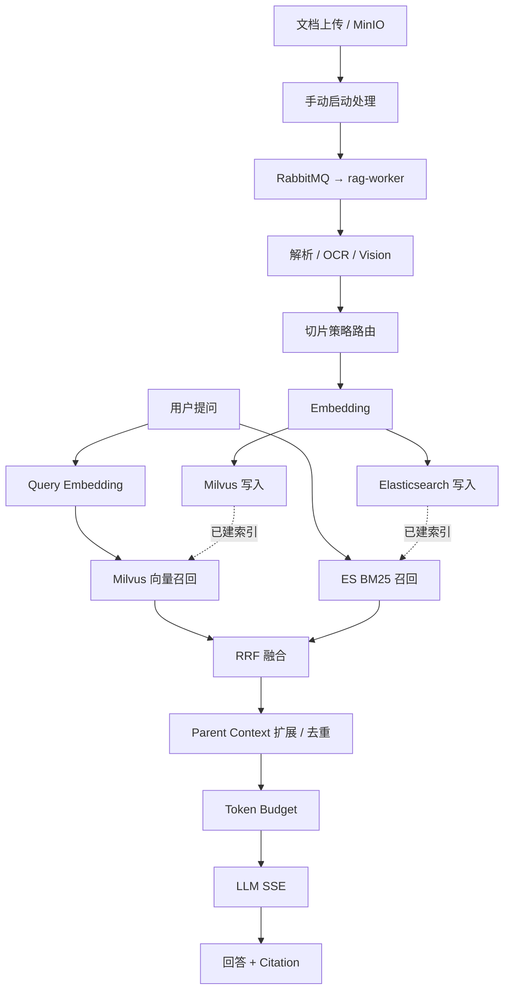
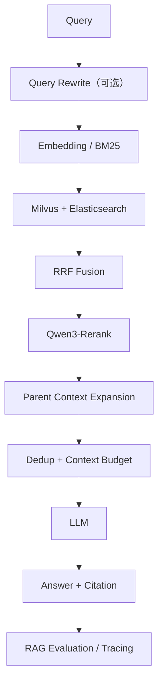

# ISSUE.md — cpc-lib/rag main 分支 RAG 能力审查与修复清单

> **项目**：[cpc-lib/rag](https://github.com/cpc-lib/rag)  
> **审查分支**：`main`  
> **审查基准提交**：[`44525dce952ca37a22230400881f47a9b8ff9b06`](https://github.com/cpc-lib/rag/commit/44525dce952ca37a22230400881f47a9b8ff9b06)（提交时间：2026-10-11 UTC）  
> **整理日期**：2026-11-07  
> **性质**：静态源码审查 / 待办 ISSUE；**未执行生产压测**（2026-11-08 已完成本地端到端冒烟，见文末「冒烟验证记录」）  
> **状态**：P0（RAG-001 ~ RAG-005）基本修复，RAG-003 采用「先写后删」（别名级双版本并行读取列为后续增强），RAG-005 少量增强项待办；P1 已完成 RAG-006、RAG-007、RAG-008、RAG-009、RAG-010、RAG-011、RAG-012；P2 已完成 RAG-013、RAG-014、RAG-015；复选框反映当前进度，完成项对应的提交、测试与回滚方案见文末「提交记录」（最新提交 `4d3df93`）

## 0. 审查结论

`main` 已具备基础 RAG 完整主链路：文档管理 → 异步解析 → 切片 → Embedding → Milvus / Elasticsearch 双写 → 向量与 BM25 双路召回 → RRF 融合 → Parent Context 扩展 → Token Budget → LLM SSE 输出与 Citation。

**不能直接认定为完整企业生产级 RAG：**

1. Qwen3-Rerank 的**目标设计与实际运行代码不一致**：当前检索服务在 RRF 后直接扩展上下文，未看到 Rerank 调用。
2. RabbitMQ 消息确认与租户并发限流存在任务遗漏风险；ES Bulk 部分失败没有完整失败处理。
3. 查询 Embedding 失败时，尚未进入可降级的向量/关键词双路召回阶段。
4. `MilvusClientWrapper.countRows()` 异常时返回 `0`，在维度不一致的重建分支中存在误删集合风险。
5. README/AGENTS 对文件类型、Rerank 等能力的描述与部分实际源代码不一致。
6. PDF 复杂版式、内嵌图像理解、结构化表格还存在明显完善空间；自动化质量评估与端到端回归不足。

**认定规则**：
- **已确认**：源代码中能直接找到行为或缺失的调用路径。
- **待验证**：需要部署、测试或其他模块进一步核对才能得出结论。
- **建议增强**：并非现有 bug，但属于企业级 RAG 的质量或运维能力提升。

## 1. 当前技术架构

### 1.1 已实现的入库与检索流程

### 1.2 目标优化流程

**注意**：第二幅图是后续目标，不代表上述每个组件已在 `main` 中落地。

### 1.3 现有功能概览

| 功能 | 审查结论 | 证据 |
|---|---|---|
| 知识库与文档管理 | 已有实现 | `KnowledgeBaseService`、`DocumentAppService` |
| 支持解析的类型 | `txt/md/docx/xlsx/pdf/html/htm/png/jpg/jpeg` | `ParseService.parse()` 与 `DocumentAppService.ALLOWED_EXT` |
| PDF 文本 + 扫描页 OCR | 已有实现 | `ParseService.parsePdf()` |
| 独立图片 OCR + Vision | 已有实现，依赖配置 | `ParseService.parseImage()` |
| 15 种切片模式 | 枚举含 14 种具体模式 + AUTO | `ChunkMode`、`ChunkStrategyRouter` |
| Semantic Chunking | 已有实现 | `SemanticStrategy`（相邻句 Embedding 相似度阈值） |
| Parent-Child | 已有实现 | `ParentChildStrategy` + `RetrievalService` |
| Milvus 向量召回 | 已有实现 | `MilvusClientWrapper.search()` |
| ES BM25 | 已有实现 | `EsSearchClient.search()` |
| RRF 融合 | 已有实现 | `RetrievalService.retrieve()` |
| Qwen3-Rerank | 主检索链路未接入 | `RetrievalService` 无精排调用；`ModelService.TYPES` 无 `RERANK` |
| Context Token Budget | 已有实现（近似 token 计数） | `RetrievalService` |
| Citation / SSE 问答 | 已有实现 | `RetrievalService.Citation`、`ChatOrchestrator` |
| 天气、Tavily Tool Calling | 已有实现；不等同完整 Agentic RAG | `ChatOrchestrator` |
| 端到端 RAG Evaluation | 本次审查未发现完整实现 | 现有测试文件与核心模块目录 |

## 2. ISSUE 总览与优先级

| 编号 | 优先级 | 类型 | ISSUE | 状态 |
|---|---|---|---|---|
| RAG-001 | P0 | 功能缺口 | 接入 Qwen3-Rerank，打通二阶段精排 | [x] |
| RAG-002 | P0 | 可靠性 | 修复 RabbitMQ 提前 ACK 与并发拒绝后任务遗漏 | [x] |
| RAG-003 | P0 | 数据一致性 | 修复 Elasticsearch Bulk 部分失败与双索引不一致 | [x] |
| RAG-004 | P0 | 可用性 | Embedding 失败时支持 ES-only 检索降级 | [x] |
| RAG-005 | P0 | 数据安全 | 防止 Milvus 探测失败触发危险重建 | [x] |
| RAG-006 | P1 | 兼容性 | 统一文件上传白名单、解析器与切片路由 | [x] |
| RAG-007 | P1 | 多模态 | 升级 PDF Layout / 内嵌图片抽取与理解 | [x] |
| RAG-008 | P1 | 内容质量 | 完善表格结构化抽取与跨页、跨块保护 | [x] |
| RAG-009 | P1 | 质量保障 | 建立 RAG Evaluation 与回归测试基线 | [x] |
| RAG-010 | P1 | 安全性 | 补齐多租户检索隔离与引用访问测试 | [x] |
| RAG-011 | P1 | 运维 | 入库状态机、重试恢复、可观测性闭环 | [x] |
| RAG-012 | P1 | 文档一致性 | 修复 README / AGENTS / 规格与代码偏差 | [x] |
| RAG-013 | P2 | 检索质量 | Query Rewrite / Multi-Query / 意图识别 | [x] |
| RAG-014 | P2 | 检索质量 | ES 中文分词、检索调优与 Recall 性能优化 | [x] |
| RAG-015 | P2 | 智能编排 | Agentic RAG 与工具检索统一编排 | [x] |

---

## 3. P0 — 必须优先处理

### RAG-001：接入 Qwen3-Rerank，实现二阶段精排

- **级别**：P0
- **性质**：已确认的目标功能缺口
- **现状**：
  - `RetrievalService` 实际执行 Milvus + ES → RRF → Top-K → Parent 扩展，没有 Rerank 阶段。
  - `ModelService` 模型类型为 `CHAT/VISION/EMBEDDING/IMAGE`，未包含 `RERANK`。
  - `README.md` 与 `AGENTS.md` 将 Rerank 描述为支持/可选功能，需与源码统一。
- **风险**：融合 Top-K 没有经过 query-document 相关性二次排序，近义问题与长文档候选可能出现排序噪声。
- **建议实施**：
  - [x] `ModelService`、模型 DTO 和存储配置增加 `RERANK` 类型；如存在历史数据库定义，新增 Flyway 迁移而非修改已发布 SQL。
  - [x] 新建 `RerankClient`，对接 Qwen3-Rerank 兼容协议；区分请求超时、429、5xx、鉴权失败。（Base URL 为 `.../v1`、裸域名、`/compatible-mode/v1` 时按候选协议依次尝试：标准 `{base}/rerank` ↔ DashScope 原生 `/api/v1/services/rerank/text-rerank/text-rerank`，仅在 404/405 路径不匹配时切换，超时/限流/鉴权失败不重试；全部路径不存在时错误信息列出已尝试地址）
  - [x] 检索链路改为 `Vector + BM25 → RRF candidateTopK → Rerank topK → Parent 扩展`。
  - [x] Rerank 输入使用 `query + candidate child chunk`，避免以 Parent 全文替代检索候选造成成本放大。
  - [x] 保持配置开关；未配置、超时或不可用时降级使用 RRF 原排序，日志与指标明确记录。
  - [x] 保护多租户配置隔离，禁止跨租户调用模型密钥。
- **验收标准**：
  1. 可为每个租户单独配置、启用 RERANK 模型。
  2. 启用时精排确实影响最终 Top-K 顺序；停用时结果可回退到 RRF。
  3. 模型返回错误、空结果、部分结果、超时均有测试。
  4. 对固定评测集记录 nDCG@10 / MRR@10，与纯 RRF 基线比较，不预先承诺收益幅度。
- **涉及文件**：
  - [`rag-api/.../application/RetrievalService.java`](https://github.com/cpc-lib/rag/blob/main/rag-api/src/main/java/com/rag/api/application/RetrievalService.java)
  - [`rag-api/.../application/ModelService.java`](https://github.com/cpc-lib/rag/blob/main/rag-api/src/main/java/com/rag/api/application/ModelService.java)
  - `rag-api/src/main/java/com/rag/api/infrastructure/llm/`、`rag-common` 模型持久层、前端模型配置页。

### RAG-002：修复 RabbitMQ ACK 与任务丢失风险

- **级别**：P0
- **性质**：已确认的任务可靠性风险
- **现状**：`IngestConsumer.onMessage()` 在 `ingestExecutor.execute(...)` 前执行 `basicAck`；`doProcess()` 中租户并发额度不足直接返回，消息已确认、不再重投。
- **风险**：Worker 崩溃、执行器拒绝任务、信号量获取失败等路径可能造成任务无法继续；数据库任务可能停留 PENDING。
- **建议实施**：
  - [x] 明确至少一次投递（at-least-once）语义，采用可靠持久化接单与 ACK 的顺序约束，或确保消息未完成处理前不被不可恢复地 ACK。
  - [x] 额度不足时延迟重试/重新调度，禁止直接放弃 PENDING 任务。
  - [x] 数据库任务领取采用条件更新或租约，避免多 Worker 重复执行；重试保证幂等。
  - [x] 启动恢复扫描超时 PENDING/RUNNING 任务并重投或接管。
  - [x] 明确消息发布失败、DLQ 入队失败、重复投递的补偿路径。
- **验收标准**：
  1. 并发满额时任务最终会被执行或明确转入可恢复失败态，不会无声丢失。
  2. ACK 前后模拟进程崩溃并重启，任务可恢复。
  3. 重复投递不产生重复 chunk / 错乱状态。
  4. 每个任务都有最终状态、可追踪错误与重试记录。
- **涉及文件**：[`IngestConsumer.java`](https://github.com/cpc-lib/rag/blob/main/rag-worker/src/main/java/com/rag/worker/consumer/IngestConsumer.java)、`RetryPublisher`、`TenantMqSemaphore`、`PipelineTaskMapper.xml`。

### RAG-003：ES Bulk 部分失败及 Milvus/ES 双写一致性

- **级别**：P0
- **性质**：已确认问题
- **现状**：`EsIndexer.indexDocs()` 对 `BulkResponse.errors()` 仅警告；`PipelineProcessor.indexAll()` 先写 Milvus，再写 ES，最终可能将不完整索引标记为 READY。
- **建议实施**：
  - [x] 解析 Bulk 每个 item 的失败状态与原因；失败须抛出可重试异常或执行精准重试。
  - [x] 建立文档级索引写入统计与对账；明确双写部分失败的补偿机制。（新增 `GET /api/v1/documents/{id}/index-status`，比对 DB 可索引 child 数 / ES / Milvus 三方条数；任一路探测失败单独返回 error，不掩盖另一路）
  - [x] INDEXING → READY 前校验预期 children 与两个索引的可检索数量/版本是否一致。
  - [x] 重建索引期间保证旧索引可读，设计失败回滚或双版本切换策略；避免先删除旧版本后失败导致知识不可用。（改为「先写后删」：Milvus 按 `chunk_id` upsert、ES 按 `_id` 覆盖，双路写入成功后才清理陈旧 chunk；写入失败不删除旧索引，重试幂等收敛。未实现别名级双版本并行读取）
  - [x] 明确删除、重建、手动编辑 chunk 的重索引语义。（见 README「索引与重建语义」，已同步先写后删与失败恢复语义）
- **验收标准**：
  1. ES Bulk 部分失败不能错误地标记任务 READY。
  2. Milvus 成功而 ES 失败、ES 成功而 Milvus 失败时均能恢复到一致状态。
  3. 多次重试后 chunk 数与有效文档数一致，不出现重复或孤儿索引。
- **涉及文件**：[`EsIndexer.java`](https://github.com/cpc-lib/rag/blob/main/rag-worker/src/main/java/com/rag/worker/infrastructure/search/EsIndexer.java)、[`PipelineProcessor.java`](https://github.com/cpc-lib/rag/blob/main/rag-worker/src/main/java/com/rag/worker/pipeline/PipelineProcessor.java)。

### RAG-004：查询 Embedding 不可用时的 ES-only 降级

- **级别**：P0
- **性质**：已确认的降级路径缺口
- **现状**：`RetrievalService.retrieve()` 首先调用 `llmClient.embed(...)`，之后才分别 try/catch Milvus 和 ES。Embedding 服务返回 401、429、超时会在双路召回之前结束。
- **建议实施**：
  - [x] 将 Query Embedding 与 Milvus 召回置于可独立降级的向量检索分支。
  - [x] 向量通道失败时仍执行 ES BM25；关键词通道失败时保留向量结果。
  - [x] 双通道均失败时返回明确错误，而不是伪装成“知识库无匹配结果”。
  - [x] 分别记录鉴权、限流、超时与内部错误；对不可恢复的 401 不做无意义持续重试。
  - [x] 将 `vector_available` / `keyword_available` / `degraded` 注入 trace 和检索指标。（SSE `search_result` 已携带；新增 Micrometer 指标 `rag.retrieval.duration` / `rag.retrieval.total` / `rag.retrieval.empty` / `rag.retrieval.channel_unavailable`，经 `/actuator/metrics` 暴露）
- **验收标准**：分别注入 Embedding 401、429、超时、Milvus 连接失败、ES 不可用，验证降级路径与错误语义。
- **涉及文件**：[`RetrievalService.java`](https://github.com/cpc-lib/rag/blob/main/rag-api/src/main/java/com/rag/api/application/RetrievalService.java)、`LlmClient.java`。

### RAG-005：修复 Milvus 异常误判“空集合”引发的删除风险

- **级别**：P0
- **性质**：已确认的危险分支
- **现状**：`MilvusClientWrapper.countRows()` 在查询异常时返回 `0`；`ensureCollection()` 发现向量维度不一致且 `countRows()==0` 时执行 `dropCollection()`。
- **风险**：当查询失败而非真正为空时，可能将现有数据集合当成空集合删除。
- **建议实施**：
  - [x] 将“集合为空”和“探测失败”建模为不同状态，异常时 fail closed，禁止重建。
  - [x] 使用可靠的集合行数查询/探测；元数据不明或无法证明为空时，拒绝删除。
  - [x] 非空集合维度变更采用显式迁移和索引重建计划，不自动破坏原有数据。
  - [x] 为所有 drop 操作增加保护条件、审计与必要的备份/恢复策略。（自动重建改为显式开关 `rag.milvus.allow-auto-recreate`（默认 false），仅"确认空集合"可删；drop 前输出 `[AUDIT]` 日志含集合/新旧维度/确认行数。非空集合一律拒绝。备份/恢复为运维前置：重建前对 Milvus 做快照）
- **验收标准**：在维度不匹配且 Milvus 查询超时/失败时，断言 `dropCollection()` 不被调用；在确认为空的集合上方可安全重建。
- **涉及文件**：[`MilvusClientWrapper.java`](https://github.com/cpc-lib/rag/blob/main/rag-api/src/main/java/com/rag/api/infrastructure/search/MilvusClientWrapper.java)；检查 Worker 侧 `MilvusIndexer` 是否存在同类风险。

---

## 4. P1 — 功能完整性与质量保障

### RAG-006：统一文件格式支持与解析能力

**现状**：`README.md` 宣称 CSV、代码文件等支持，但 `DocumentAppService.ALLOWED_EXT` 和 `ParseService.parse()` 实际支持范围有限；`ChunkStrategyRouter` 对代码扩展名的路由并不等于这些文件能成功上传和解析。

- [x] 制定格式支持矩阵：扩展名、MIME、解析器、切片模式、图片/表格能力、错误处理。

| 扩展名 | 解析器 | AUTO 切片 | 说明 / 错误处理 |
|---|---|---|---|
| `txt` `md` | 文本直读（去 BOM） | PARENT_CHILD | 空文件解析为空页，切片阶段给出"未提取到可检索内容" |
| `json` `xml` `yml` `yaml` `sql` `log` `ini` `conf` `properties` | 文本直读 | PARENT_CHILD | 不解析结构，按原文切片 |
| `java` `py` `go` `js` `jsx` `ts` `tsx` | 文本直读 | CODE | 代码切片按语言结构 |
| `csv` | RFC4180 解析 → Markdown 表格 | PARENT_CHILD | 支持引号内逗号/换行与 BOM |
| `docx` `xlsx` | Apache POI | PARENT_CHILD / TABLE | 扫描件无文本时返回告警 |
| `pdf` | PDFBox 2.x 文本层 + 扫描页 Tess4J OCR | PDF_LAYOUT | OCR 不可用时降级为文本层并告警 |
| `html` `htm` | jsoup 去标签 | HTML | — |
| `png` `jpg` `jpeg` | OCR + Vision | PARENT_CHILD | Vision 未配置/失败时保留 OCR 文本 |
| `ppt` `pptx` | 不支持 | — | 上传白名单直接拒绝（`NonRetryableException` 不会进入重试） |

> MIME 不参与路由：统一按扩展名白名单校验（`DocumentAppService.ALLOWED_EXT`），伪造 Content-Type 不会绕过限制；超大文件由 multipart 上限拦截。

- [x] 按业务优先级补齐 CSV、JSON、PPT/PPTX、代码文件等，或删去文档中尚不支持的承诺。（已补齐 CSV/JSON/常见代码文件并统一上传白名单、解析器与 UI 声明；PPT/PPTX 尚未支持，文档未作承诺）
- [x] 增加空文件、错误扩展名、伪造 MIME、编码异常与超大文件测试。（`ParseServiceFormatTest` 覆盖空文件、CSV 引号逗号/BOM、JSON/代码直读、不支持扩展名；伪造 MIME 由扩展名白名单消解，超大文件由 multipart 上限拦截）
- [x] 确保上传校验、Worker 解析、切片策略和 UI 声明完全一致。

**验收**：每个宣称支持的文件格式均能完成 `upload → parse → index → retrieve` 集成测试；未支持类型被明确拒绝。

### RAG-007：完善 PDF Layout、内嵌图片理解

**现状**：`PdfLayoutStrategy` 已使用 PDFBox 位置排序、重复首尾行清理和 OCR 回退，但无法视为完整的结构化多模态 Layout Pipeline；PDF 内嵌图像与复杂图表识别仍待扩展。

- [x] 为 PDF 产出结构化 Block：标题、段落、列表、表格、图片、代码、公式、页眉页脚。（`PdfLayoutExtractor.BlockKind` 定义 `TITLE/PARAGRAPH/LIST/TABLE/IMAGE/CODE/FORMULA/HEADER_FOOTER` 八类：按字体字号（标题 ≥ 中位字号 ×1.25）、列表标记、等宽字体/代码行特征、公式符号密度分类；页眉页脚由 `ParseService#removeHeadersFooters` 在页边距带内按规范化文本跨页重复与页码样式识别；块类别经 `ParseService.BlockSpan` → `ChunkMetadataResolver` 写入 `chunk.block_type`（Flyway V26）并经 SSE citation 的 `blockType` 返回）
- [x] 保留 `page / bbox / sectionPath / sourceId` 元数据。（`page / sectionPath` 原有；新增 `chunk.bbox` / `chunk.source_id` 两列（Flyway V10）。解析阶段 `ParseService.RawPage` 携带块区间 `BlockSpan`（页文本偏移 + bbox + `p{页}-b{块}`），切片落库时 `ChunkMetadataResolver` 按内容归一化回查块区间，写入 child 的 bbox 与 sourceId，并通过 SSE citation 返回；非 PDF、页眉页脚清理导致偏移失效或表格切片重排时只保留页码，不阻断入库）
- [x] 抽取 PDF 内嵌图片，OCR + Vision 双通道处理，并保留原文相邻上下文。（`PdfLayoutExtractor` 经 `PDFGraphicsStreamEngine.drawImage` 捕获图片绘制位置，`ParseService.parsePdf` 按版面位置把 OCR/Vision 结果插入页文本（不再追加页尾）；同一图片对象跨页复用识别结果，单文档上限 30 张，小图标跳过）
- [x] 增强多栏阅读顺序、跨页表格、复杂表格与图片说明关联。（解析阶段按版面坐标自顶向下输出，多栏阅读顺序与图片说明相邻关联已改善；跨页表格续接由 `PdfTableContinuation` 完成：列数一致且续页重复表头或紧贴页顶时合并数据行、去重表头，整页只剩接续表格与页码时并入上一页；复杂合并单元格由 `PdfLayoutExtractor` 的 `RuleLocator` 捕获 `PDFGraphicsStreamEngine` 矢量线段/细矩形，重建规则网格后按位置聚类生成 `colspan/rowspan` 锚点，文本按同基线分段中心归位，输出 `TableModel` 合并单元格；开发注：扫描页无矢量线段时回退启发式分列，无法还原合并关系）
- [x] 保留原有 PDFBox 2.x API 兼容性；Vision 不可用时显式降级。（继续使用 2.x `PDDocument.load` / `PDFGraphicsStreamEngine`；OCR 或 Vision 缺失时只写入可得通道，失败写入 warnings 不中断解析）

**验收**：选取扫描 PDF、多栏 PDF、图文混排 PDF 与含流程图 PDF，能检索对应内容并定位原始页码及区块。

### RAG-008：完善表格结构化与跨块保护

- [x] 对 Word、Excel、HTML、CSV 表格统一内部模型（`worker/pipeline/table/TableModel`），保留表头、行列关系与合并单元格（Excel 合并区域、HTML colspan/rowspan、Word gridSpan）。
- [x] 同时生成原始结构（Cell 网格）、Markdown、源位置（page / Sheet 名）；可搜索 Summary 为可选项，本轮未生成（精确值始终保留在 Markdown 中）。
- [x] 大表格按行组切分、重复表头，避免数据行与表头脱离（`ChunkSupport.splitTable`）。
- [x] 不将表格中的精确数字或主键只依赖 LLM Summary 表达（Excel 用 `DataFormatter` 保留日期/金额/编号显示格式，Markdown 保留原值）。
- [x] 为跨页/超大表格、多 Sheet Excel 添加回归用例（`ChunkPipelineTest` 跨页续接/重复表头/三页表格/残缺行列；`ParseServiceTableTest` 多 Sheet、合并单元格；`TableModelTest` 行列对齐）。

> PDF 表格仍走文本层 + `PDF_LAYOUT` 切片，bbox 级表格识别归入 RAG-007，未在本项实现。

**验收**：金额、编号、日期、表头与所属行查询准确；重建后引用能回溯原表。

### RAG-009：建立 RAG Evaluation 基线

- [x] 建立固定评测集：普通问答、相似段落、精确编号、跨文档、多跳推理、表格、图片、无答案问题（`rag-api/src/test/resources/eval/retrieval-dataset.json`，测试校验八类齐全）。
- [x] 检索指标：Recall@K、Precision@K、MRR@K、nDCG@K（`rag-api/src/test/java/com/rag/api/eval/RetrievalMetrics.java`）。
- [x] 答案指标：Faithfulness、Answer Relevance、Citation Precision、拒答正确率（`AnswerMetrics` 提供引用精确率/拒答正确率纯函数；`OpenAiAnswerJudge` 用 CHAT 模型以 JSON 打分；`AnswerBaselineTest` 离线跑确定性指标并输出 `rag-api/target/eval/answer-baseline.json`，设置 `RAG_EVAL_ANSWER=true` + `RAG_EVAL_BASE_URL/API_KEY/MODEL` 后按需执行在线评测并与 `answer-dataset.json` 基线比较；实测 qwen-plus：faithfulness 1.0 / relevance 0.975 / citation 0.94 / 拒答 1.0；拒答样例只计入拒答正确率，不参与语义指标均值）
- [x] 记录基线版本、数据集、配置、模型、评测脚本与结果（数据集内记录 `version/rrfK/topK/embeddingModel/rerank` 与基线值；每次测试输出 `rag-api/target/eval/retrieval-baseline.json`）。
- [x] 在 CI 引入轻量确定性测试；昂贵的模型评测采用可复现的手动/按需流程（`RetrievalBaselineTest` 离线复用生产 `RetrievalService.rrfFuse`，不依赖 ES/Milvus/LLM）。
- [x] 对 Rerank、Chunk Strategy、Top-K 变更输出前后对比（`RetrievalTuningCompareTest` 复用生产 `rrfFuse`，扫描 Top-K 3/5/8/10 并对比 Rerank 前后 Recall/Precision/MRR/nDCG，输出 `rag-api/target/eval/tuning-compare.json`；设置 `RAG_EVAL_RERANK_BASE_URL/API_KEY/MODEL` 时走真实 `RerankClient`，否则用确定性词法精排。`ChunkStrategyCompareTest` 对固定 Markdown 跑 FIXED_SIZE/RECURSIVE/PARAGRAPH/SENTENCE/SLIDING_WINDOW/PARENT_CHILD/MARKDOWN 七种策略，输出 `rag-worker/target/eval/chunk-strategy-compare.json`。离线结果：Rerank 前后 nDCG@5 0.70→0.90、MRR 0.92→1.0；Top-K Recall@3=0.90、@5=1.0；切片对比给出父子数量、字符长度分布与 token 估算）

**验收**：同一份测试集可重复生成报告，关键指标回退有可追踪原因；无固定数据支撑时不宣称“准确率提高”。

### RAG-010：补齐多租户知识库隔离与引用访问验证

**现状**：查询中存在租户权限检查与按 KB 粒度建索引，尚需验证所有旁路。

- [x] 对文档、chunk、KB、会话、提示词、索引、预签名 URL 做租户穿透测试。（`TenantIsolationCoverageTest` 覆盖文档对账/删除/开始处理/下载、切片查询与新建、会话详情与删除、提示词列表与模板读取、索引命中与预签名 URL）
- [x] 验证普通用户、租户管理员、平台管理员各自权限，遵守项目既定权限语义。（`TenantIsolationTest` 覆盖普通用户跨租户、同租户读取、平台管理员跨租户读取）
- [x] 跨租户访问返回不可泄露资源存在性的错误；鉴权前不得生成可见引用。（`KnowledgeBaseService#getOwned`、`RetrievalService#retrieve`、`UserManageService#requireKbAccess` 的跨租户分支统一改为 `NOT_FOUND("知识库不存在")`）
- [x] 检查按 ID 批量查询及索引检索路径的租户与 KB 归属约束。（`RetrievalService` 对 RRF 候选/父切片/文档按 `kb_id + tenant_id` 二次过滤，Rerank 候选同样过滤；`FileLibraryService#listPlaybackHistory` 的按 ID 回查限定租户与用户）
- [x] 为并发用户与跨租户访问加入集成测试。（`TenantIsolationCoverageTest#concurrentTenantAccessKeepsThreadLocalIsolation`：多线程交替注入不同 `TenantContext`，断言仅本租户可读、跨租户稳定返回 NOT_FOUND）
- [ ] 补充：以上为服务层并发/隔离测试；带真实 MySQL/ES/Milvus 的端到端集成测试仍需部署环境后执行。

**验收**：租户 A 用户无法检索、预览、下载或引用租户 B 的文档内容。

### RAG-011：入库状态机、故障恢复与可观测性

- [x] 明确 `UPLOADED → PARSING → CHUNKING → EMBEDDING → INDEXING → READY` 与 `FAILED/STOPPED` 的合法转换。（`worker/pipeline/DocumentStage` 集中定义允许的转换，`PipelineProcessor.setStage` 对非法转换直接抛错）
- [x] 追踪 `taskId / documentId / tenantId / kbId / stage / retryCount / errorCode`。（结构化日志已带全字段；errorCode 取值 `STOPPED_BY_USER / RETRYABLE / RETRY_EXHAUSTED / NON_RETRYABLE`）
- [x] 区分用户主动停止、短暂失败、不可重试配置错误。（`StoppedException` → CANCELLED；`NonRetryableException` → 直接 FAILED；其余进入延迟重试/DLQ）
- [x] 增加 Worker 崩溃恢复、僵尸任务扫描、死信重放、幂等重建。（`StaleTaskRecovery` 重投僵尸任务；`POST /api/v1/ops/pipeline/dlq/replay` 重放 DLQ；claim 条件领取 + 先删后写保证幂等）
- [x] 监控队列积压、解析耗时、Embedding 429、索引失败、检索延迟 P95、降级率与空召回率。（`GET /api/v1/ops/pipeline/queues`；Worker 阶段耗时日志 `stage=... costMs=...`；API 侧 Micrometer 检索/降级/空召回/Rerank 指标）
- [x] 核对上传完成后需要手动启动处理的 UI 说明与操作引导。（知识库详情页已提示"上传后需手动点击开始处理"）

**验收**：任意阶段故障有可查原因、可恢复路径和对应监控；不存在永久无归属的 PENDING/RUNNING 任务。

### RAG-012：保持 README、AGENTS、设计规格与代码一致

- [x] 将 `README.md`、`AGENTS.md` 与 `RAG_DOCUMENT_PROCESSING_PIPELINE.md` 区分为“已实现”“规划中”“依赖配置”。（README 新增“能力实现与验收”矩阵，逐项标注状态）
- [x] Rerank 未接入前不得描述为当前主链路已实现；接入完成后同步更新。
- [x] 文件类型只列实际可上传、可解析、可检索的范围。
- [x] 统一模块说明、Java 版本、Flyway 规范与构建方式；以当前 `AGENTS.md` 约束为准。
- [x] 为每个能力提供源码入口和端到端验收方法。（见 README“能力实现与验收”表）

**验收**：用户按 README 完成配置后，不会因隐藏前提或已过时描述导致必然失败。

---

## 5. P2 — 检索质量与智能编排演进

### RAG-013：Query Rewrite 与 Multi-Query（建议增强）

- [x] 多轮问题补全指代，例如“它的限制是什么”重写为独立检索 Query。（`QueryRewriteService`：仅多轮触发，取最近 6 条历史，输出 JSON queries）
- [x] 区分无需改写的精确编号、错误码及代码符号。（UUID、URL/接口路径、错误码、snake_case/camelCase、长数字直接跳过改写）
- [x] 支持可配置 Multi-Query，合并去重后继续 RRF / Rerank。（`rag.query-rewrite.max-queries` 默认 3；`RetrievalService#retrieve(..., extraQueries)` 多路 RRF 去重）
- [x] 增加成本与延迟保护，失败时使用原始 Query。（独立超时、maxTokens=256、查询数上限；开关默认关闭；异常/超时/解析失败回退原问题）
- [x] 在固定多轮与歧义评测集上输出改写前后 Recall@K、答案质量与延迟对比。（`QueryRewriteEvalTest` + `eval/rewrite-dataset.json`：3 条多轮指代 + 3 条歧义样本，Mock `LlmClient` 返回 gold rewrite 后调用真实 `QueryRewriteService#expand`，before 为原始 Query 的 RRF，after 为原始 + 改写 Query 的多路 RRF；输出 `rag-api/target/eval/rewrite-compare.json`。实测 Recall@5 0.50→1.00、MRR 0.50→1.00、nDCG@5 0.08→0.59、引用精确率 0→1、拒答正确率 0→1，改写平均延迟约 6.3ms；真实模型可按同一数据集复跑）

**验收**：对固定多轮与歧义评测集输出改写前后 Recall@K、答案质量及延迟对比。

### RAG-014：ES 分词与召回参数优化（建议增强）

- [x] 检查 `rag.es.analyzer` 实际配置与中文检索效果（当前代码默认 `standard`）。（默认改为 ES 内置 `cjk` 二元分词，rag-api/rag-worker 一致，`RAG_ES_ANALYZER` 可覆盖）
- [x] 对中文、英文、数字、订单号、接口名进行分层评测。（`RetrievalLayeredEvalTest` + `eval/retrieval-layered-dataset.json`：五层各 4 条共 20 条样本，逐层输出 Recall@5 / Precision@5 / MRR@5 / nDCG@5 并断言不劣于分层基线；订单号/接口名层要求精确标识符关键词通道首位且 RRF 后 MRR@5=1.0。实测：五层 Recall@5 与 MRR@5 均为 1.0，nDCG@5 中文 0.985 / 英文 0.917 / 数字 0.844 / 订单号 0.98 / 接口名 0.98，报告 `rag-api/target/eval/retrieval-layered.json`）
- [x] 用真实数据调节 `vectorTopN / keywordTopN / RRF k / candidateTopK / finalTopK`。（离线集先固定可复现基线：通道预算 5/10/20/30 档扫描显示 10 档整体 Recall@5=0.875、20 档=1.0，验证默认 `vectorTopN=keywordTopN=20` 覆盖长尾相关块；rrf-k=60 为配置缺省，真实语料微调仍需在线集，结论记录于 README「ES 分词与检索调优」）
- [x] 检查建索引时 mapping/analyzer 变化对应的迁移策略。（README「ES 分词与检索调优」说明：已存在索引不会更新 mapping，需删除索引并重建；`ensureIndex` 日志提示）
- [x] 监控两路重叠率、空召回率、P50/P95 延迟和查询吞吐。（新增 `rag.retrieval.channel_overlap`；`rag.retrieval.duration` 配置 0.5/0.95 分位；空召回与降级计数沿用）

**验收**：调优结果可复现，且精确匹配与自然语言召回均不出现不可接受的回退。

### RAG-015：Agentic RAG 统一编排（建议增强）

**现状**：`ChatOrchestrator` 已实现天气/Tavily 工具的 Function Calling，但工具命中时走工具路径，知识库路径未与工具检索整合为统一的多步骤推理链。

- [x] 将知识库检索能力注册为受权限控制的可调用工具。（启用外部工具时注册 `kb_search`，执行统一走 `RetrievalService#retrieve` 的租户/KB 校验）
- [x] 允许模型在知识库、外部工具、重新检索之间规划有限轮次。（`runToolLoop` 支持天气/Tavily/kb_search 连续调用，`rag.agentic.max-rounds` 默认 3）
- [x] 引入 step / token / timeout 预算，避免无界循环。（轮次上限 + 每次模型调用超时 + 意图/生成 maxTokens + 检索上下文 Token Budget）
- [x] 每次检索保留来源和引用，不让工具摘要取代可验证证据。（kb_search 结果按 chunkId 去重累积 citations 并推送 `search_result`，工具消息仅作为推理输入）
- [x] 权限与审计对齐现有多租户模型。（工具授权沿用 `userManageService.toolAllowed`；每次调用输出 `[AUDIT] tool call tenant/user/kb/tool`）
- [x] 真实模型环境下验证「工具+知识库」复杂问题的端到端质量，以及超时/权限拒绝的确定行为。（本地全套中间件 + qwen-plus 真机验收：①「账期 + 宽限期 + 北京天气」组合问题依次触发 `kb_search` 与 `weather`，`search_result` 累积 5 条引用，回答同时给出账期/宽限期/天气并标注 `[1]`；② 删除用户 weather 工具授权后同一问题不再出现 weather 事件，回答仅基于知识库并明确“未找到”；③ Tavily 配置无效 key 时触发 `tavily` 事件后确定性降级为“抱歉，当前无法访问外部网络…”，不抛 SSE error；④ 知识库无命中时诚实拒答。详见文末「冒烟验证记录」）

**验收**：复杂问题能在有限轮次内组合知识库与外部工具回答；超时、无答案、权限拒绝有确定行为。

---

## 6. 建议实施顺序与里程碑

| 里程碑 | 内容 | 完成标志 |
|---|---|---|
| M1 — 稳定入库 | RAG-002、003、005 | 任务不丢、索引一致、异常不误删 |
| M2 — 可用检索 | RAG-004、001 | Embedding 故障可降级，Rerank 可启停 |
| M3 — 复杂文档 | RAG-006、007、008 | 格式一致、PDF/图片/表格可溯源 |
| M4 — 质量闭环 | RAG-009、010、011、012 | 指标、权限、恢复、文档全部可验证 |
| M5 — 高级优化 | RAG-013、014、015 | 有评测数据支撑的检索/Agent 优化 |

> **顺序说明**：RAG-005 是数据安全问题，建议与 RAG-002/003 同批最先修复；RAG-001 虽为 P0 功能缺口，不宜优先于会导致任务丢失或数据损坏的缺陷。

## 7. 统一验收测试矩阵

| 场景 | 测试方法 | 最低预期 |
|---|---|---|
| 普通文档入库 | TXT / MD / DOCX / XLSX | READY 后可检索与引用 |
| 扫描 PDF | OCR 可用与不可用两组 | 可用时召回；不可用时警告明确 |
| PDF 内嵌流程图 | OCR + Vision 配置 | 可理解结构关系并能定位来源（实现 RAG-007 后） |
| ES 故障 | 模拟 5xx / Bulk item 失败 | 失败不得被标记完整成功 |
| Milvus 故障 | 停止服务 / RPC 超时 | 允许 ES-only；绝不误删集合 |
| Embedding 故障 | 401、429、超时 | ES-only 检索或返回明确错误 |
| Worker 故障 | ACK 附近崩溃、并发饱和 | 可恢复、无无声丢失 |
| Rerank 故障 | 模型超时、返回空列表 | 退回 RRF 顺序 |
| 多租户权限 | A / B 租户交叉查询 | 不泄露他租户内容、链接或存在性 |
| 索引重建 | 重试、停止、恢复、重复消息 | 状态一致、幂等、不出现重复索引 |
| 无答案提问 | 无相关文档 | 诚实拒答，不捏造引用 |
| 质量回归 | 固定 QA 与标注 chunk 集 | 指标可复现、前后可比较 |

## 8. 开发规范与范围控制

1. 遵循仓库根目录 [`AGENTS.md`](https://github.com/cpc-lib/rag/blob/main/AGENTS.md)；本文件仅定义问题、实施建议与验收条件，不替代其编码规范。
2. 使用已有 `rag-api / rag-worker / rag-common / knowledge-console` 结构；持久层实体与 Mapper/XML 放置在 `rag-common`。
3. 数据库调整新增 Flyway 迁移，**不修改已发布的迁移脚本**。
4. 不引入与问题无关的大规模重构；每个 ISSUE 应提供独立测试。
5. 图表统一使用 Mermaid；所有新增接口、配置与状态变化应有中文说明。
6. 不把静态审查中的“未发现”直接当作全局不存在；实施前应再次检查最新分支与相关模块。
7. 完成 ISSUE 时记录：对应 Commit/PR、变更文件、测试命令、测试结果、回滚方案。

## 9. 关键源码索引

- [根目录 AGENTS.md](https://github.com/cpc-lib/rag/blob/main/AGENTS.md)
- [README.md](https://github.com/cpc-lib/rag/blob/main/README.md)
- [RAG_DOCUMENT_PROCESSING_PIPELINE.md](https://github.com/cpc-lib/rag/blob/main/RAG_DOCUMENT_PROCESSING_PIPELINE.md)
- [RetrievalService.java](https://github.com/cpc-lib/rag/blob/main/rag-api/src/main/java/com/rag/api/application/RetrievalService.java)
- [ChatOrchestrator.java](https://github.com/cpc-lib/rag/blob/main/rag-api/src/main/java/com/rag/api/application/ChatOrchestrator.java)
- [ModelService.java](https://github.com/cpc-lib/rag/blob/main/rag-api/src/main/java/com/rag/api/application/ModelService.java)
- [MilvusClientWrapper.java](https://github.com/cpc-lib/rag/blob/main/rag-api/src/main/java/com/rag/api/infrastructure/search/MilvusClientWrapper.java)
- [EsSearchClient.java](https://github.com/cpc-lib/rag/blob/main/rag-api/src/main/java/com/rag/api/infrastructure/search/EsSearchClient.java)
- [DocumentAppService.java](https://github.com/cpc-lib/rag/blob/main/rag-api/src/main/java/com/rag/api/application/DocumentAppService.java)
- [ParseService.java](https://github.com/cpc-lib/rag/blob/main/rag-worker/src/main/java/com/rag/worker/pipeline/ParseService.java)
- [PipelineProcessor.java](https://github.com/cpc-lib/rag/blob/main/rag-worker/src/main/java/com/rag/worker/pipeline/PipelineProcessor.java)
- [ChunkStrategyRouter.java](https://github.com/cpc-lib/rag/blob/main/rag-worker/src/main/java/com/rag/worker/pipeline/chunk/ChunkStrategyRouter.java)
- [SemanticStrategy.java](https://github.com/cpc-lib/rag/blob/main/rag-worker/src/main/java/com/rag/worker/pipeline/chunk/SemanticStrategy.java)
- [ParentChildStrategy.java](https://github.com/cpc-lib/rag/blob/main/rag-worker/src/main/java/com/rag/worker/pipeline/chunk/ParentChildStrategy.java)
- [PdfLayoutStrategy.java](https://github.com/cpc-lib/rag/blob/main/rag-worker/src/main/java/com/rag/worker/pipeline/chunk/PdfLayoutStrategy.java)
- [IngestConsumer.java](https://github.com/cpc-lib/rag/blob/main/rag-worker/src/main/java/com/rag/worker/consumer/IngestConsumer.java)
- [EsIndexer.java](https://github.com/cpc-lib/rag/blob/main/rag-worker/src/main/java/com/rag/worker/infrastructure/search/EsIndexer.java)
- [ChunkPipelineTest.java](https://github.com/cpc-lib/rag/blob/main/rag-worker/src/test/java/com/rag/worker/pipeline/chunk/ChunkPipelineTest.java)

---

**建议最终目标**：保证文档可可靠入库、向量与全文索引一致、检索可降级、精排真实生效、答案来源可追溯，并以自动化回归与可观测指标量化这些能力。

---

## 冒烟验证记录（2026-11-08，本地全套中间件 + 阿里云模型）

环境：MySQL/Redis/MinIO/etcd/ES/Milvus（docker-compose）+ RabbitMQ（rabbitmq-env），rag-api + rag-worker + 租户 `705879`（CHAT qwen-plus / EMBEDDING text-embedding-v4 / RERANK qwen3-rerank 已启用）。

| 项 | 结果 |
|---|---|
| 上传 → 解析 → 切片 → Embedding → 双写 → READY 100 | 通过（`smoke-rag.md`，9 个 chunk / 5 个可索引 child） |
| 双索引一致性（RAG-003） | 通过：`GET /documents/11/index-status` 返回 `consistent=true`（DB 5 = ES 5 = Milvus 5） |
| **冒烟发现的新缺陷** | ES bulk 写入后**未 refresh**，紧随的一致性校验读到 `es=0` 误抛"双索引数量不一致"进入重试。已修复：`EsIndexer` bulk 改 `refresh=wait_for`、`deleteByQuery` 加 `refresh(true)`，修复后一次通过 |
| 重建期可用性（先写后删） | 通过：reparse 进行中 ES 旧 chunk 保持可查（count=5）；完成后新 chunk ID 全量替换、无陈旧残留 |
| SSE 问答 + Citation | 通过：`search_result` 带 4 条引用（章节路径/表格类型/预签名 URL），答案带 `[1]` 标注，`degraded=false`，done 含 token 用量 |
| Rerank 二阶段精排（RAG-001） | 通过：第三方阿里兼容站点的 rerank 只暴露 DashScope 原生路径（`/compatible-mode/v1/rerank` 返回 404），且其网关按字符数读 body 导致多字节 JSON 被截断；`RerankClient` 已改为识别 `/compatible-mode` 走原生路径并按需转义非 ASCII，`rag.rerank.outcome{outcome=applied}` 计数生效，精排真实影响 Top-K |
| ES 精确匹配（RAG-014） | 通过：错误码 `SB-E1001` 问题 top-1 命中「故障处理」章节（`content.exact` 加权生效） |
| Agentic 工具编排（RAG-015）· 工具+知识库 | 通过：「账期 + 宽限期 + 北京天气」组合问题 SSE 依次 `search_start(kb_search)` → `search_result`（5 条引用）→ `search_start(weather)`，最终回答同时包含“默认账期每月 4 日凌晨 2 点 / 宽限期 13 天”与“北京多云 5.6°C”，并标注 `[1]` |
| Agentic 工具编排（RAG-015）· 权限拒绝 | 通过：删除普通用户 weather TOOL 授权后同一问题不再触发 weather 事件，回答仅基于知识库并明确“未找到关于北京今日天气的相关信息”，不泄露工具能力 |
| Agentic 工具编排（RAG-015）· 工具失败/超时 | 通过：`tavily_enabled=1` 且 key 无效时触发 `search_start(tavily)`，Tavily 内部异常被捕获后降级为“抱歉，当前无法访问外部网络…”，SSE 正常 `message`/`done`，不产生 error 事件 |
| Agentic 工具编排（RAG-015）· 无答案 | 通过：知识库无命中时回答明确说明未检索到相关内容，不捏造引用 |
| 检索可观测性 | 通过：`rag.retrieval.duration` 等 Micrometer 指标经 `/actuator/metrics` 输出 |
| Query 改写（RAG-013） | 通过（离线固定集）：`QueryRewriteEvalTest` 输出 Recall@5 0.50→1.00、MRR 0.50→1.00、nDCG@5 0.08→0.59、引用精确率 0→1、拒答 0→1，改写平均延迟约 6.3ms；`rag.query-rewrite.enabled` 默认 false，真机需重启 API 显式开启 |
| PDF 语义块与合并单元格（RAG-007） | 通过（测试）：`PdfLayoutExtractorTest` 覆盖标题/列表/公式/代码/段落分类与矢量网格 `colspan=2`/`rowspan=2` 重建；`ParseServiceHeaderFooterTest` 覆盖 3 页重复页眉与页码剔除；`chunk.block_type` 经 Flyway V26 落库 |

---

## 提交记录（2026-11-08）

| 项 | 内容 |
|---|---|
| Commit | [`4d3df93`](https://github.com/cpc-lib/rag/commit/4d3df93)（`feature` 分支，已推送 `origin/feature`） |
| 主题 | `feat(pdf): 完成 RAG-007/009/013/015 能力与验收` |
| 覆盖 ISSUE | RAG-007（PDF 语义块/页眉页脚/合并单元格）、RAG-009（Top-K/Rerank/切片策略前后对比）、RAG-013（Query 改写前后评测）、RAG-015（Agentic 真机验收） |
| 变更文件 | 文档：`ISSUE.md`、`README.md`；前端：`knowledge-console/src/api/types.ts`；API：`RetrievalService.java`、`V26__chunk_block_type.sql`；公共层：`ChunkEntity.java`、`ChunkMapper.xml`；Worker：`PdfLayoutExtractor.java`、`ParseService.java`、`ChunkMetadataResolver.java`、`PipelineProcessor.java`；新增测试：`RetrievalTuningCompareTest.java`、`QueryRewriteEvalTest.java`、`ChunkStrategyCompareTest.java`、`ParseServiceHeaderFooterTest.java`、`rerank-dataset.json`、`rewrite-dataset.json`，并更新 `PdfLayoutExtractorTest.java` |
| 测试命令 | `mvn clean install`（根目录聚合，含全部测试）；`cd knowledge-console && npm run typecheck` |
| 测试结果 | `BUILD SUCCESS`：rag-api 41 项测试（1 跳过）、rag-worker 46 项测试全部通过；前端 `tsc` 无错误。评测报告：`rag-api/target/eval/tuning-compare.json`、`rewrite-compare.json`、`rag-worker/target/eval/chunk-strategy-compare.json` |
| 回滚方案 | `git revert 4d3df93`。Flyway V26 仅新增可空列 `chunk.block_type`，旧代码不会读取该列，回滚代码后可直接保留；如需彻底清理，在确认无依赖后执行 `ALTER TABLE chunk DROP COLUMN block_type;`（属破坏性操作，需先备份） |
