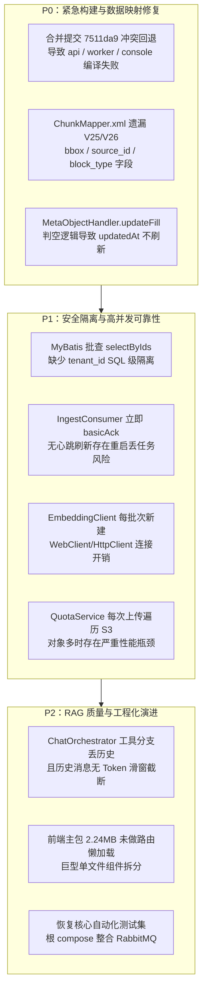

# 项目全面审查与优化评估报告（OPTIMIZE.md）

> **审查时间**：2026-11-22  
> **审查范围**：`rag-common`、`rag-api`、`rag-worker`、`knowledge-console`、`docker-compose.yml` 及数据库迁移脚本（Flyway V1–V27）  
> **评级定义**：
> - **P0（紧急阻断）**：导致编译失败、核心功能不可用或数据静默丢失，需立即修复。
> - **P1（高优先级）**：涉及多租户安全隔离、分布式一致性、OOM/连接泄漏风险或计费配额失真。
> - **P2（中长期优化）**：涉及 RAG 检索问答质量、前端性能与代码可维护性、测试与运维工程化。

---

## 一、总体评估结论

本项目整体架构清晰，具备完整的多租户 RAG 核心闭环（S3 对象存储 + 15 种切片策略 + Parent-Child 层次索引 + Milvus/ES 双路召回 + RRF/Rerank + Agentic 工具编排 + 索引别名双版本重建）。

但通过本次全量代码静态审查与构建验证，发现**当前 `main` 分支在合并提交 `7511da9` 后处于编译失败状态**，且在持久层字段映射、多租户 SQL 兜底隔离、Worker 消息确认与内存管理、配额统计性能、多轮对话上下文管理等方面存在明确的优化空间。



---

## 二、P0 级问题：构建阻断与数据静默丢失（需立即修复）

### 2.1 Git 合并提交 `7511da9` 冲突回退导致三大模块编译失败

- **问题根因**：在合并提交 `7511da9`（`Merge remote-tracking branch 'origin/main'`）中，17 个冲突文件（如 `RetrievalService.java`、`PipelineProcessor.java`、`ParseService.java`、`ChunkMapper.xml`、`types.ts` 等）保留了本地旧提交 `091aae4` 的版本，而未冲突文件（如 `ChatOrchestrator.java`、`MilvusIndexer.java`、`ChunkMetadataResolver.java`、`KnowledgeBasesPage.tsx`）引入了远端 `49c24e0` 的新代码，导致跨文件接口签名断裂。
- **具体报错清单**：
  1. **`rag-api` 编译失败（7 处错误）**：
     - `ChatOrchestrator.java:133` 调用 `retrievalService.retrieve(session, kbId, question, rewritten)`（4 参数，支持 Query Rewrite）及 `rr.degraded()` / `rr.vectorAvailable()` / `rr.keywordAvailable()`；
     - 但 `RetrievalService.java:70` 被回退为 3 参数 `retrieve(session, kbId, question)`，`RetrievalResult` 也缺少降级状态字段。
  2. **`rag-worker` 编译失败（5 处错误 + 1 处 Maven 警告）**：
     - `PipelineProcessor.java:225` 调用旧签名 `milvusIndexer.insert(String, List<long[]>, List<float[]>)`，与新 `MilvusIndexer.java` 不匹配；
     - `ChunkMetadataResolver.java:29,50` 依赖 `ParseService.RawPage.spans()` 与 `ParseService.BlockSpan`，但 `ParseService.java` 被回退；
     - `ParseService.java:378` 中 `VectorOpCounter` 未实现 `PDFGraphicsStreamEngine.closePath()`；
     - `rag-worker/pom.xml:164` 重复声明了两次 `spring-boot-starter-test`。
  3. **`knowledge-console` 类型检查失败（5 处错误）**：
     - `src/api/types.ts` 被回退，丢失了 `KbRebuildView` 及 `KnowledgeBase` 的 `indexVersion`、`indexState`、`indexTargetVersion` 字段，导致 `src/api/knowledgeBases.ts` 与 `src/pages/KnowledgeBasesPage.tsx` 执行 `npm run typecheck` 失败。
- **修复建议**：以 `49c24e0`（`origin/main`）的 17 个冲突文件为基线，将 `091aae4` 中增量部分（S3 `ObjectStorage` 命名与 PDF 图片切片 `imageUrl` 引用展示）最小化合入，确保 `mvn clean compile` 与 `npm run typecheck` 零错误通过。

### 2.2 `ChunkMapper.xml` 遗漏 `V25` / `V26` 新增字段（PDF 版面元数据静默丢失）

- **代码位置**：
  - `rag-api/src/main/resources/db/migration/V25__chunk_layout_metadata.sql`
  - `rag-api/src/main/resources/db/migration/V26__chunk_block_type.sql`
  - `rag-common/src/main/java/com/rag/api/infrastructure/persistence/entity/ChunkEntity.java:31-35`
  - `rag-common/src/main/resources/mapper/ChunkMapper.xml:5-92`
- **问题描述**：数据库 `chunk` 表与 `ChunkEntity` 均已新增 `bbox`、`source_id`、`block_type` 三个字段，但 `ChunkMapper.xml` 的 `Base_Column_List`、`insert`、`insertBatch`、`updateById` 均未包含这三列。这导致 Worker 解析出的 PDF 版面坐标和语义块类型无法写入数据库，API 端也无法读取。
- **修复建议**：在 `ChunkMapper.xml` 的 `Base_Column_List`、`insert`、`insertBatch`、`updateById` 中补齐 `bbox`、`source_id`、`block_type` 映射。

### 2.3 `MetaObjectHandler.updateFill` 判空逻辑缺陷导致 `updatedAt` 不更新

- **代码位置**：`rag-common/src/main/java/com/rag/api/infrastructure/persistence/config/RagPersistenceAutoConfiguration.java:44-53`
- **问题描述**：
  ```java
  @Override
  public void updateFill(MetaObject metaObject) {
      fillIfNull(metaObject, "updatedAt", LocalDateTime.now());
  }
  ```
  当业务代码先通过 `selectById` 查询出实体（此时 `entity.getUpdatedAt()` 已有历史值，不为 `null`），修改属性后再调用 `updateById(entity)` 时，`fillIfNull` 会因为 `updatedAt != null` 而跳过赋值！对于 `LibraryFileMapper.xml:81`（`updated_at = #{updatedAt}`）这类使用实体属性更新的 SQL，会把旧的 `updatedAt` 原样写回数据库。
- **修复建议**：
  - `updateFill` 中应直接覆盖更新：`if (metaObject.hasSetter("updatedAt")) { metaObject.setValue("updatedAt", LocalDateTime.now()); }`。
  - 同时为 `DocumentEntity`、`KnowledgeBaseEntity`、`ChunkEntity`、`PipelineTaskEntity` 补齐 `createdAt` / `updatedAt` 字段，并在对应 Mapper XML 的 `updateById` 中统一使用 `updated_at = NOW()`。

---

## 三、P1 级问题：多租户安全、高并发稳定性与配额准确性

### 3.1 多租户 SQL 批查缺少 `tenant_id` 过滤（违反编码约定 §8.4）

- **代码位置**：
  - `rag-common/src/main/resources/mapper/ChunkMapper.xml:101-106`（`selectByIds`）
  - `rag-common/src/main/resources/mapper/DocumentMapper.xml:93-98`（`selectByIds`）、`86-91`（`selectPageByKbId`）
  - `rag-common/src/main/resources/mapper/KnowledgeBaseMapper.xml:78-83`（`selectByIds`）
- **问题描述**：`AGENTS.md` §8.4 明确规定“SQL 必须带 `tenant_id` 条件，不允许跨租户 IN 批查遗漏隔离”。目前上述 `selectByIds` 仅包含 `WHERE deleted = 0 AND id IN (...)`，未在 SQL 层绑定 `tenant_id = #{tenantId}`。若 Milvus/ES 索引命名或共享集合配置出现疏漏，攻击者或异常索引返回的跨租户 `chunkId` 会直接在 `RetrievalService` 中把其他租户的切片与文档内容查出拼入 Prompt。
- **优化建议**：将 `selectByIds` 签名统一调整为 `selectByIds(@Param("tenantId") String tenantId, @Param("ids") Collection<Long> ids)`，在 SQL `WHERE` 子句强制增加 `AND tenant_id = #{tenantId}`。

### 3.2 `JwtAuthFilter` 全局放开 `?token=` 查询参数带来的凭证泄露风险

- **代码位置**：`rag-api/src/main/java/com/rag/api/interfaces/security/JwtAuthFilter.java:75-81`
- **问题描述**：为支持 `<video>/<audio>` 标签播放，过滤器对**所有 API 路径**都允许通过 URL Query `?token=xxx` 传递会话 JWT。URL 中的 Token 极易被记录在反向代理访问日志、浏览器历史记录及 Referer 头中。
- **优化建议**：
  - 仅在白名单媒体流路由（如 `/api/v1/library/*/stream`、`/api/v1/chunks/*/image`）允许读取 `?token=`；
  - 更佳实践是为媒体播放签发短有效期（如 5 分钟）、仅限单文件读取的短期签名 Ticket，不直接暴露主会话 JWT。

### 3.3 自定义模型 Base URL 的 SSRF（服务端请求伪造）风险

- **代码位置**：`rag-api/src/main/java/com/rag/api/application/ModelService.java`、`LlmClient.java`
- **问题描述**：租户管理员可在控制台配置模型 `baseUrl` 并触发后端请求。虽然存在“第三方地址出站确认”，但缺少对目标 Host/IP 的网络边界校验。恶意租户可将 `baseUrl` 指向宿主机或内网中间件（如 `http://127.0.0.1:9200` ES、`http://127.0.0.1:2379` etcd、`http://169.254.169.254` 云厂商元数据服务）探测内网。
- **优化建议**：在保存和发起模型 HTTP 调用前解析目标 Host：对非平台超级管理员禁止访问回环地址（`127.0.0.0/8`）、链路本地地址（`169.254.0.0/16`）及中间件所在内网网段（除非显式列入平台允许的本地推理白名单端口，如 Ollama `11434`）。

### 3.4 Worker 立即 `basicAck` 与长耗时任务心跳缺失

- **代码位置**：
  - `rag-worker/src/main/java/com/rag/worker/consumer/IngestConsumer.java:60-62`
  - `rag-worker/src/main/java/com/rag/worker/consumer/StaleTaskRecovery.java`
- **问题描述**：
  1. `IngestConsumer` 收到消息后在进入线程池前立即 `channel.basicAck(tag, false)`。若此时 Worker 进程重启或崩溃，已在内存线程池排队或正在执行的任务将丢失。
  2. 虽然引入了 `StaleTaskRecovery` 扫描 `status IN ('PENDING','RUNNING') AND updated_at < NOW() - INTERVAL X MINUTE`，但对于大体积 PDF（数百页 OCR + Vision + 数百批次 Embedding），单次正常执行可能耗时 15~30 分钟，且期间只更新了 `document` 表进度，**并未更新 `pipeline_task.updated_at`**。这会导致 `StaleTaskRecovery` 要么把正常执行中的长任务误判为僵尸任务重复投递，要么超时阈值设得过大导致故障恢复极慢。
- **优化建议**：
  - 在 `PipelineProcessor.setStage(...)` 更新文档进度的同时，同步刷新 `pipeline_task.updated_at = NOW()` 作为任务心跳；
  - 将 `IngestConsumer` 中的 `taskMapper.updateById` 替换为条件更新 `taskMapper.claimPending(task.getId())`（判断返回值 `== 1`），彻底杜绝并发重复执行。

### 3.5 `EmbeddingClient` 每批次新建 `HttpClient` / `WebClient` 造成连接与内存浪费

- **代码位置**：`rag-worker/src/main/java/com/rag/worker/infrastructure/llm/EmbeddingClient.java:117-124`
- **问题描述**：在 `embedBatch` 方法的每次调用（每 10 条切片一批）及每次重试循环中，都会执行 `HttpClient.create()` 与 `WebClient.builder()...build()`。处理一份 2,000 切片的文档会创建 200 个独立的 Reactor Netty `HttpClient` 实例，且未关闭底层连接池，高并发下易造成 Direct Memory 与文件描述符激增。
- **优化建议**：在 `@PostConstruct` 中构建并复用共享的 `HttpClient` 与 `WebClient.Builder`（按需使用 `ConnectionProvider.builder("embedding").maxIdleTime(Duration.ofSeconds(20)).build()` 避免空闲长连接被中间网络设备 RST），请求时仅动态传入完整 URI 与 Header。

### 3.6 存储配额每次上传全量遍历 S3 对象列表（严重性能瓶颈）

- **代码位置**：`rag-api/src/main/java/com/rag/api/application/QuotaService.java:46-57`、`ObjectStorage.java`（`sumSizeByPrefix`）
- **问题描述**：每次上传文档、图片或分片前都会调用 `QuotaService.checkStorage` → `minioStorage.sumSizeByPrefix(tenantId + "/")`，底层通过 S3 `listObjectsV2` 分页遍历该租户下所有对象并累加字节数。当租户积累了上万个对象（尤其是视频 HLS 转码切片、PDF 内嵌图片、派生文件）时，每次上传前都会触发数十次 S3 List 请求，延迟高达数秒。
- **优化建议**：
  - 将 `storageUsedBytes` 缓存在 Redis（`rag:quota:storage:{tenantId}`，TTL 10 分钟），上传/删除文件时通过 `INCRBY` / `DECRBY` 实时维护增量；
  - 或后台定时任务每小时与对象存储对账校准一次。

### 3.7 Agentic 工具调用轮次漏记 Token 消耗 & SSE 限流计数器 TTL 误过期

- **代码位置**：
  - `rag-api/src/main/java/com/rag/api/application/ChatOrchestrator.java:112-115, 195-196`
  - `rag-api/src/main/java/com/rag/api/interfaces/guard/SseConnectionGuard.java:28-39`
- **问题描述**：
  1. **Token 漏记**：`ChatOrchestrator` 在 `chatOnce`（意图预判与 `runToolLoop` 多轮工具调用）中未读取响应的 `usage.prompt_tokens` / `completion_tokens` 累加到 `promptTokens` 和 `completionTokens`。若模型在非流式工具轮直接给出最终回答（`answered = true`，第 208 行），整次问答落库的 Token 消耗为 **0**，导致租户月度 Token 配额统计严重失真。
  2. **SSE 限流 Key 误过期**：`SseConnectionGuard.acquire` 仅在 `count == 1` 时设置 10 分钟过期。若租户在 10 分钟内始终保持至少 1 个活跃 SSE 连接（`count` 未归零），10 分钟到达时 Redis Key 会被强制过期删除，导致当前活跃连接数被清零，限流失效。
- **优化建议**：
  - `LlmClient.chatOnce` 返回结果中保留 `usage` 节点并在每次调用后累加到 `promptTokens` / `completionTokens`；
  - `SseConnectionGuard.acquire` 在每次 `increment` 时都刷新 `expire(key, Duration.ofMinutes(10))`（或改用带时间戳的 Redis ZSet 维护活跃连接 ID，自动清理超时僵尸连接）。

### 3.8 大文档解析的内存峰值（OOM 风险）

- **代码位置**：`rag-api/src/main/resources/application.yml:28`（`max-file-size: 500MB`）、`rag-worker/src/main/java/com/rag/worker/pipeline/ParseService.java`
- **问题描述**：配置允许上传最大 500MB 的文件，但 `ParseService` 中多处使用 `byte[]` 全量加载或 `PDDocument.load(InputStream)`（默认在堆内存构建整棵 PDF 对象树）、Apache POI `XSSFWorkbook` / `XWPFDocument` 全量 DOM 解析。100MB 的 `.xlsx` 或 `.pdf` 在解析时堆内存膨胀可达 1GB~2GB，多租户并发解析时极易触发 Worker OOM。
- **优化建议**：
  - 按文件类型细分大小上限：视频/音频允许 500MB，但文档类（PDF/DOCX/XLSX）限制在 50MB~100MB；
  - PDFBox 2.x 调用 `PDDocument.load(stream, MemoryUsageSetting.setupMixed(32 * 1024 * 1024L))` 开启内存+临时磁盘混合模式。

---

## 四、P2 级问题：RAG 检索问答质量、前端性能与工程化

### 4.1 多轮对话历史缺乏 Token 滑窗截断，且工具分支丢失历史上下文

- **代码位置**：`rag-api/src/main/java/com/rag/api/application/ChatOrchestrator.java:83-85, 144, 182-184`
- **问题描述**：
  1. **长会话撑爆上下文**：`chatSessionService.historyMessages` 会查出会话下的**全部历史消息**并全部加入 `messages`，而 `RetrievalService` 的 `maxContextTokens=12000` 仅限制了当轮检索到的 `citations` 材料，未对 `history` 做最近 N 轮或 Token 预算裁剪。
  2. **工具分支丢失多轮历史**：`runToolLoop`（第 182 行）构建 `messages` 时只放了 `system` 和当前 `user` 问题，**完全没有放入 `history`**（第 112 行的意图预判同样没传 `history`）。导致用户在多轮对话中追问“那北京呢？”、“把刚才查到的结果结合知识库对比一下”时，工具路由与参数提取因缺少上文而失败。
- **优化建议**：
  - 为 `history` 增加滑动窗口与 Token 预算控制（例如最多保留最近 6~10 轮、总计不超过 3,000 Tokens，从最新往旧截取）；
  - 在意图预判 `chatOnce` 和 `runToolLoop` 中同样携带裁剪后的 `history`。

### 4.2 Embedding 与 Rerank 的文本表征不对称

- **代码位置**：
  - `rag-worker/src/main/java/com/rag/worker/pipeline/PipelineProcessor.java`（`embeddingText`）
  - `rag-api/src/main/java/com/rag/api/application/RetrievalService.java:271`
- **问题描述**：Worker 在生成向量和写入 ES 时，通过 `embeddingText(doc, chunk)` 为切片拼接了文档名、章节路径（`sectionPath`）及图片 OCR/Vision 文本；但 `RetrievalService.rerank` 在调用 Rerank 模型时仅传入了裸 `chunk.getContent()`。对于短切片、表格行或 IMAGE 切片（`content` 可能很短或主要信息在 `sectionPath` / `imageVision` 中），Rerank 模型因缺少文档与章节上下文会给出偏低分数。
- **优化建议**：Rerank 候选文本构造与 `embeddingText` 对齐（當 `sectionPath` 非空时拼接 `[文档名 · 章节路径] 正文`）。

### 4.3 ES + Milvus 双写与删除缺乏最终一致性对账落地

- **代码位置**：`rag-worker/src/main/java/com/rag/worker/pipeline/PipelineProcessor.java:221-239`、`DocumentAppService.java`
- **问题描述**：文档删除或重解析时，先写/删 Milvus 再写/删 ES。若其中一个存储瞬时超时或失败，容易残留孤儿向量或孤儿 ES 文档，进而在检索时召回已被逻辑删除的 `chunkId`。
- **优化建议**：
  - 在 `PipelineOpsService` 的定时巡检或重建流程中，补充按知识库维度的 `MySQL active chunks` vs `Milvus count` vs `ES count` 自动对账与孤儿 ID 清理；
  - 文档删除若遇 ES/Milvus 删除异常，记录待清理补偿任务而非仅打印 `warn` 日志。

### 4.4 前端打包体积过大（主包 2.24MB）与巨型单文件组件

- **代码位置**：
  - `knowledge-console/src/App.tsx:7-19`
  - `knowledge-console/vite.config.ts`
  - `knowledge-console/src/pages/FileLibraryPage.tsx`（1,304 行）、`ChatPage.tsx`（811 行）、`KbDetailPage.tsx`（746 行）
- **问题描述**：
  1. `App.tsx` 对所有页面均采用静态同步导入，生产构建主 chunk `index.js` 高达 **2,247 KB**（gzip 714 KB），首屏加载需要下载包含 Antd 全量组件、XLSX、docx-preview 等重型依赖的巨型 JS。
  2. `FilePreviewPage.tsx` 对所有可预览文件均先通过 `documentApi.preview(id)` 将完整 `Blob` 拉取到浏览器内存，若用户预览上百 MB 的视频或超大文本，会造成长时间白屏等待与浏览器内存飙升。
  3. `FileLibraryPage.tsx`（1,304 行）单文件耦合了分片上传、SHA256 哈希、HLS 播放器、字幕编辑、文件列表 5 大职责，维护成本较高。
- **优化建议**：
  - 在 `App.tsx` 中使用 `React.lazy(() => import('./pages/...'))` + `<Suspense>` 实现路由级代码分割，并在 `vite.config.ts` 配置 `manualChunks` 将 `antd`、`xlsx`、`docx-preview` 拆分为独立 chunk；
  - `FilePreviewPage.tsx` 对视频/音频改用流式 URL（支持 HTTP Range）而非全量 `Blob` 下载，对纯文本/Markdown 预览增加大小上限保护（如超过 5MB 提示下载查看）；
    - **已核实（不重复实现）**：文档上传白名单不含音视频，`/api/v1/documents/{id}/preview` 的视频/音频分支当前不可达；文件库 `GET /api/v1/library/files/{id}/stream` 已支持 `Range`/`206` 流式播放并覆盖该场景，故本次不新增实现。详见 `docs/optimize-p2/spec.md` 第 3 节。
  - 将 `FileLibraryPage.tsx` 中的分片上传逻辑抽离为 `useMultipartUpload` Hook，视频播放弹窗抽离为 `VideoPlayerModal` 组件。

### 4.5 自动化测试防线缺失与本地 `docker-compose.yml` 完整性

- **代码位置**：
  - `HANDOFF.md:9`（commit `c23bb08` 移除了 34 个测试文件）
  - `docker-compose.yml` 与 `rabbitmq-env/docker-compose.yml`
- **问题描述**：
  1. 目前三个后端模块（`rag-common`、`rag-api`、`rag-worker`）的 `src/test` 目录已被清空，**自动化测试覆盖率为 0%**。这也是 `7511da9` 合并引发编译错误和 `ChunkMapper.xml` 字段丢失未能被及时发现的直接原因。
  2. 根目录 `docker-compose.yml` 包含 MySQL、Redis、RustFS、etcd、ES、Milvus，唯独缺少 `rabbitmq`（被放在 `rabbitmq-env/docker-compose.yml`），导致一键启动中间件后无法直接运行 `rag-worker`。
- **优化建议**：
  - 恢复轻量、无外部强依赖的核心单元测试（① MyBatis Mapper XML 与 Entity 字段对齐反射校验测试；② 15 种 `ChunkStrategy` 切片单测；③ `RetrievalService` RRF 融合与 Token 预算截断单测）；
  - 将 `rabbitmq` 服务合并进根目录 `docker-compose.yml`，实现真正的一键启动全套中间件。

---

## 五、分阶段落地路线图（Roadmap）

| 阶段 | 优先级 | 核心任务 | 预期收益 |
|---|---|---|---|
| **第一阶段：止血与构建恢复** | **P0** | 1. 修复 `7511da9` 合并回退的 17 个文件，恢复 `rag-api` / `rag-worker` / `knowledge-console` 编译通过<br>2. 补齐 `ChunkMapper.xml` 的 `bbox`、`source_id`、`block_type` 字段<br>3. 修复 `RagPersistenceAutoConfiguration.updateFill` 覆盖更新 `updatedAt` | 消除编译报错，恢复 PDF 版面溯源与索引双版本能力 |
| **第二阶段：安全与高并发加固** | **P1** | 1. `selectByIds` 全部补齐 `tenant_id` SQL 条件<br>2. `JwtAuthFilter` 限制 `?token=` 作用路由；模型 `baseUrl` 增加内网 SSRF 校验<br>3. `EmbeddingClient` 复用 `WebClient`；`QuotaService` 存储用量引入 Redis 缓存；补齐工具调用轮 Token 计量 | 消除跨租户数据越权隐患，杜绝高并发下连接泄漏与上传卡顿 |
| **第三阶段：RAG 质量与工程化** | **P2** | 1. `ChatOrchestrator` 多轮历史增加 Token 滑窗截断，并传入工具调用分支<br>2. Rerank 输入对齐 `sectionPath` 上下文；Worker 增加长任务心跳刷新<br>3. 前端路由 `React.lazy` 懒加载与大组件拆分；根 `docker-compose.yml` 合入 RabbitMQ 并恢复核心单测 | 显著提升多轮 Agentic 问答准确率，首屏包体缩减 60%+，建立回归防护网 |
