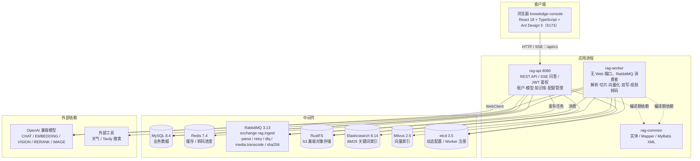
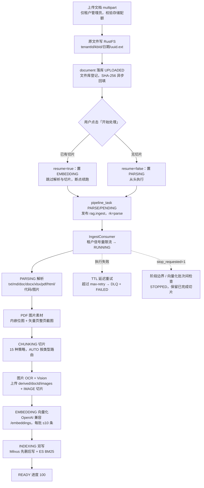
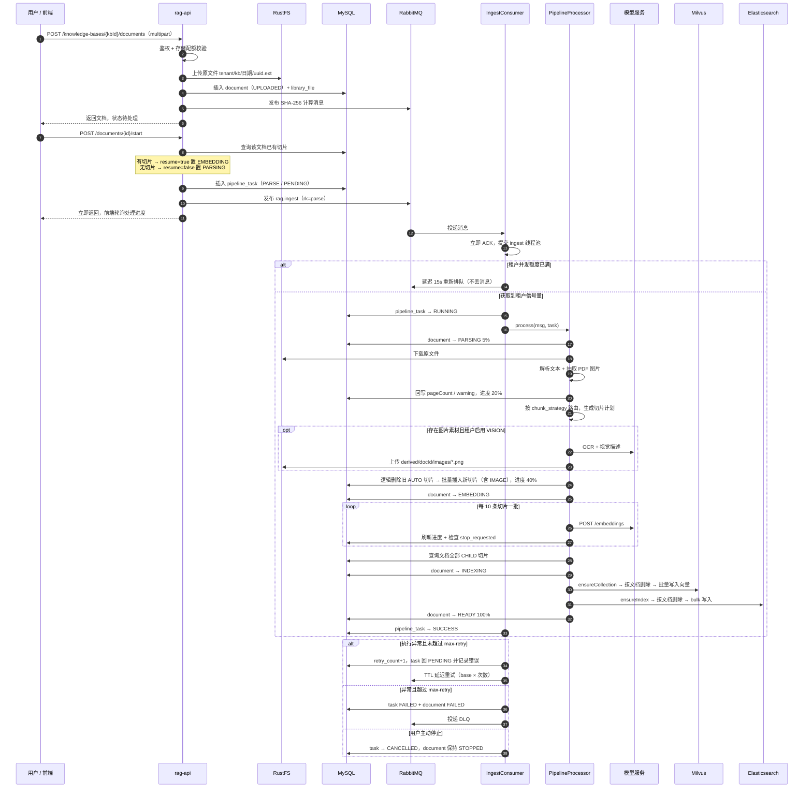
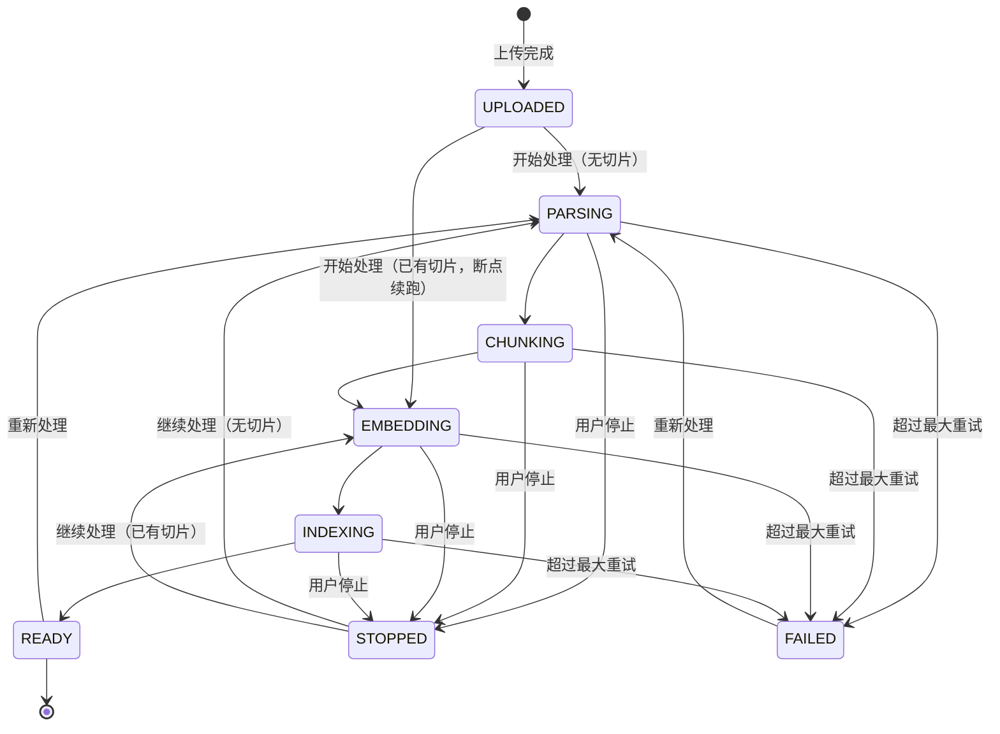
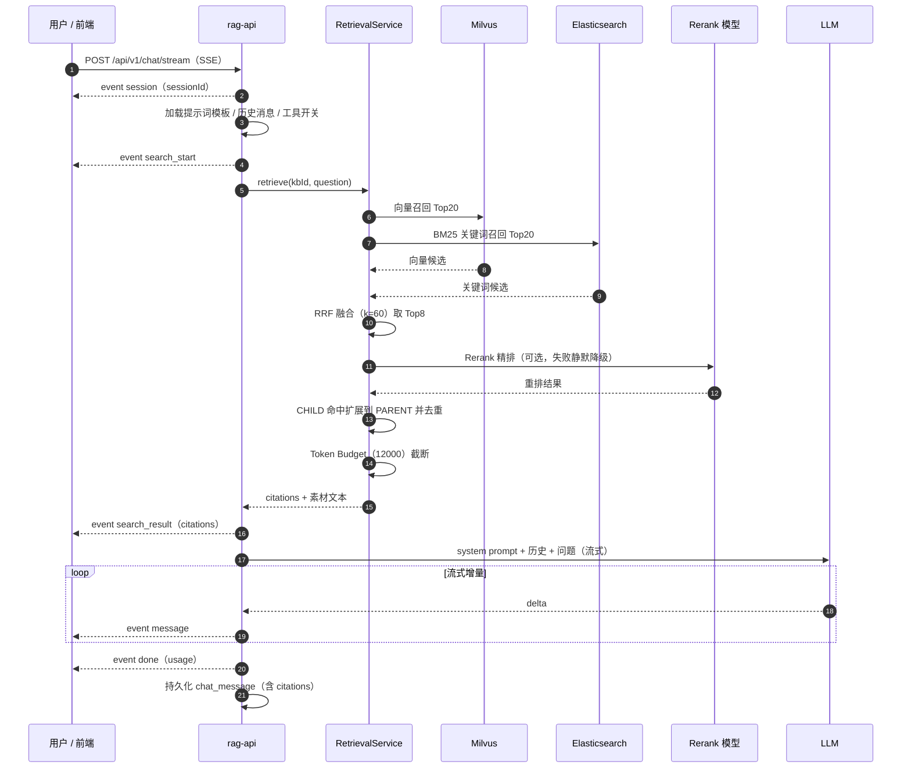
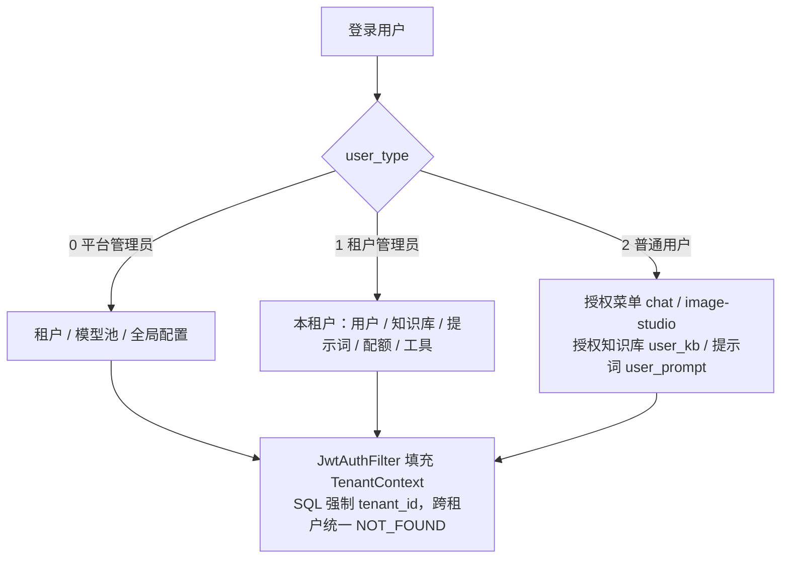
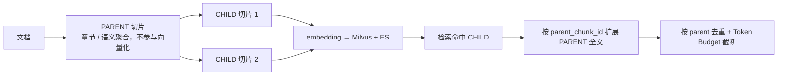
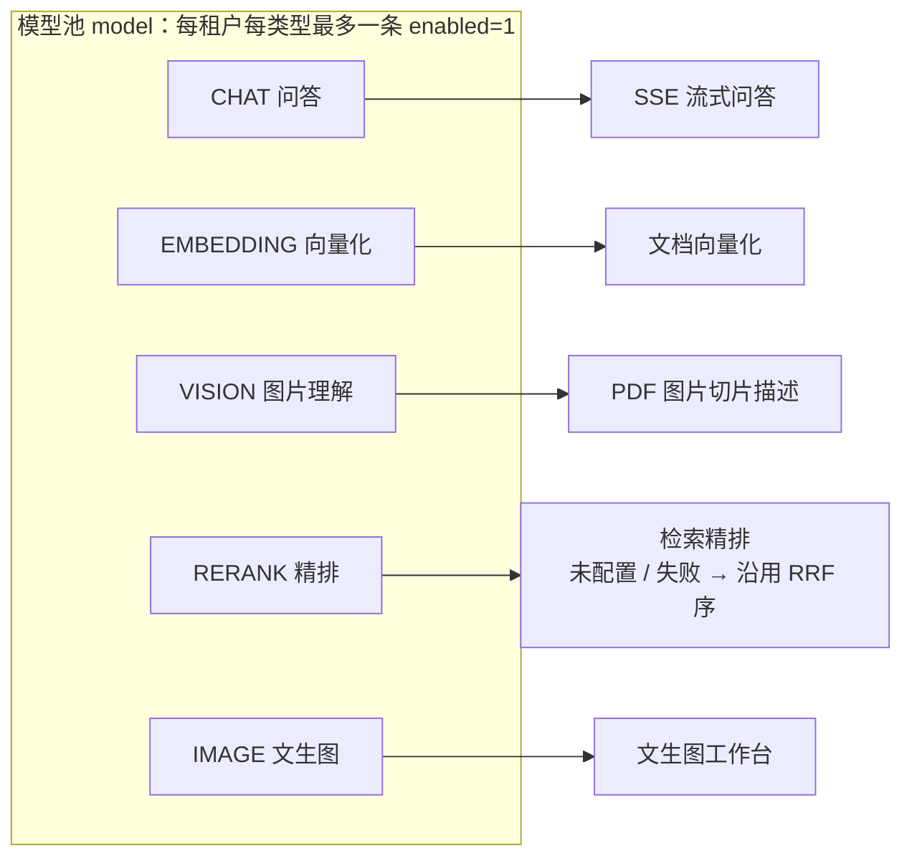

# 多租户 RAG 知识库问答平台

租户隔离的知识库管理 + 文档异步解析流水线 + 混合检索 + LLM 流式问答 + AI 文生图 + 文件库与视频转码。

## 功能特性

- **多租户隔离**：超级租户 / 租户管理员 / 普通用户三级体系，数据按 `tenant_id` 全链路隔离；菜单、工具、知识库、提示词多级授权
- **文档处理流水线**：上传 → RabbitMQ 异步消费 → 解析 → 切片 → Embedding → Elasticsearch + Milvus 双写，支持失败延迟重试与死信
- **多格式解析**：txt / md / docx / xlsx / csv / pdf（文本层 + 扫描件 Tess4J OCR）/ html / 代码文件 / 图片（Vision 多模态）
- **15 种切片策略**：固定大小、递归、段落、句子、语义、结构化、Markdown、HTML、PDF 版面、表格、QA、Parent-Child、滑动窗口、代码、AUTO
- **混合检索**：Milvus 向量召回 + ES BM25 关键词召回 → RRF 融合 → 可选 Rerank 精排 → Parent 内容扩展 → Token Budget 截断
- **流式问答**：SSE 输出（检索过程 / 引用来源 / 正文增量 / 用量统计），支持多轮会话与提示词模板；历史会话可删除（逻辑删除）
- **AI 文生图**：独立画图工作台，生成结果持久化到对象存储（RustFS），保留个人历史记录
- **文件库**：S3 原生分片上传（断点续传）+ 在线播放，视频自动转 HLS（H.264+AAC，NVENC 优先），音频/文本/图片即点即播；支持重新转码
- **字幕翻译**：多语言字幕导入/编辑/翻译，支持 SRT/VTT/ASS，翻译结果存档到文件库；目标语言由租户在「目标语言管理」维护；字幕条有备份表（subtitle_cue_backup），删除字幕记录后文件库归档仍可编辑
- **运维能力**：租户存储配额管理、etcd 动态配置热更、Worker 服务注册、视频转码 WebSocket 实时进度

## 技术栈

| 层 | 技术 |
|---|---|
| 后端 | Java 17、Spring Boot 3.3.5、Spring WebFlux（模型调用）、MyBatis-Plus 3.5.7 |
| 前端 | React 18、TypeScript 5、Vite 5、Ant Design 5、Zustand |
| 消息 | RabbitMQ 3.13（手动 ack、TTL + DLQ 重试、租户信号量限流） |
| 存储/检索 | MySQL 8.4、Redis 7.4、RustFS（S3 兼容）、Elasticsearch 8.14、Milvus 2.5、etcd 3.5 |
| 文档处理 | Apache PDFBox 2.x、POI、jsoup、JavaParser、Tess4J |
| 模型接入 | OpenAI 兼容 HTTP 接口（Chat / Embedding / Vision / Rerank / 文生图） |
| 视频处理 | FFmpeg 7.1（HLS、NVENC、WebSocket 实时进度推送） |

## 模块结构

四个模块各自独立 pom.xml，**无 Maven 父子聚合**（根目录 `pom.xml` 仅用于聚合构建）：

```
rag/
├── rag-common/         # 公共持久层：实体 + Mapper 接口 + MyBatis XML（api / worker 共享）
├── rag-api/            # REST API + SSE 问答 + 鉴权 + 管理后台接口（端口 8080）
├── rag-worker/         # 非 Web 进程，RabbitMQ 消费者，文档解析/切片/向量化/双写/视频转码
├── knowledge-console/  # React 管理控制台（端口 5173，/api 代理到 8080）
├── docker-compose.yml  # 本地中间件
└── rag-api/src/main/resources/db/migration/  # Flyway 迁移脚本
```

- 实体 / Mapper / MyBatis XML 统一在 `rag-common`（`com.rag.api.infrastructure.persistence.*`），api 与 worker 共享，不再各自维护持久层
- 两个后端进程必须连接同一套中间件，并使用相同的 JWT 密钥与模型配置

## 系统架构



- **rag-api** 负责同步交互：鉴权、管理接口、检索编排与 SSE 流式问答，不执行重任务
- **rag-worker** 负责异步重任务：文档解析/切片/向量化/双写、视频转码、SHA-256 计算，按租户信号量限流
- **etcd** 同时承担 Milvus 元数据后端与业务动态配置（`/rag/config/global/retrieval` 可热更检索参数），Worker 启动时注册自身

## 快速开始

### 1. 环境要求

- JDK 17、Maven 3.8+、Node.js 18+、Docker / Docker Compose
- Windows 需单独配置 FFmpeg 7.1 x64 路径（`rag.media.ffmpeg-path`）

### 2. 启动中间件

```bash
docker compose up -d mysql redis rustfs rustfs-init etcd elasticsearch milvus
```

> **RabbitMQ 提示**：compose 中 `rabbitmq` 服务默认被注释，Worker 依赖它。本地运行前请取消注释后执行 `docker compose up -d rabbitmq`，或自备 RabbitMQ（5672 / 15672，guest/guest）。

所有中间件默认地址为 `127.0.0.1`（本机）。如果中间件部署在其他机器，启动后端时设置环境变量 `MIDDLEWARE_HOST=<中间件主机IP>` 即可整体切换，也可用 `MYSQL_HOST`、`RUSTFS_PORT`、`ES_PORT`、`MILVUS_PORT`、`ETCD_PORT` 等单独覆盖。

### 3. 初始化数据库

使用 **Flyway** 自动管理数据库版本，rag-api 启动时会自动执行迁移脚本。

1. 在 MySQL 中创建数据库（应用默认连接库名为 `rag`）：

   ```sql
   CREATE DATABASE rag DEFAULT CHARACTER SET utf8mb4 COLLATE utf8mb4_unicode_ci;
   ```

2. 直接启动 rag-api，Flyway 会自动执行 `V1__init_schema.sql` 建表并写入种子数据。

> 已有数据库：若库中残留旧的 `flyway_schema_history` 表（项目早期遗留），需先执行 `DROP TABLE flyway_schema_history;` 再启动，否则 Flyway 校验会失败。空库无需任何手动操作。
>
> 也可以直接使用 compose 自动创建的 `rag` 库，然后以环境变量 `MYSQL_DB=rag` 启动两个后端进程。

### 4. 启动后端

```bash
# Windows PowerShell 不支持 &&，以下命令可直接分别执行
mvn -f rag-api/pom.xml spring-boot:run      # http://localhost:8080
mvn -f rag-worker/pom.xml spring-boot:run   # 无 Web 端口，纯 MQ 消费者
```

首次启动时 rag-api 的 `DataInitializer` 会创建平台管理员种子账号：

- 用户名：`admin`
- 密码：`admin123`
- 挂载在超级租户 `000000` 下

### 5. 启动前端

```bash
cd knowledge-console
npm install
npm run dev        # http://localhost:5173
```

### 6. 登录后配置

以 admin 登录管理控制台，至少完成：

1. **模型配置**：启用 CHAT / EMBEDDING 模型（OpenAI 兼容 Base URL + API Key），否则无法问答和向量化
2. **租户管理**：创建租户与租户管理员
3. **知识库**：新建知识库（选择切片策略），上传文档等待解析完成
4. 如需 Rerank、Vision、文生图、天气 / Tavily 工具，在对应配置页填写

## 构建与测试

```bash
mvn -f rag-api/pom.xml clean compile -DskipTests
mvn -f rag-worker/pom.xml clean test          # 唯一测试：ChunkPipelineTest

cd knowledge-console
npm run typecheck                             # tsc --noEmit
npm run build
```

## 核心链路

### 文档处理



### 文档处理时序



消费者收到消息后立即 ACK，避免分钟级处理触发 RabbitMQ `consumer_timeout`；幂等由 `pipeline_task` 的 PENDING 状态约束。停止请求只在阶段边界与向量化批次间生效。

### 文档状态机



### 问答检索



SSE 事件：`session` / `search_start` / `search_result`（含引用）/ `message`（增量）/ `done`（用量）/ `error`。天气 / Tavily 工具调用复用 `search_start` 事件并携带 `stage=tool`。

**检索实现细节**

- **Query 改写**：`QueryRewriteService.expand` 默认开启，最多 3 条子查询，8 秒超时；未启用或失败时直接用原问题
- **RRF 公式**：`score = Σ 1 / (rrfK + rank)`，`rrfK=60`；双路召回各 20 条（`vectorTopN` / `keywordTopN`），融合后取 `topK=8`
- **Rerank**：`POST {base}/rerank`（`model + query + documents + top_n`），解析 `results[].relevance_score` 降序；未配置或调用异常沿用 RRF 顺序
- **上下文预算**：CHILD 命中回溯 PARENT 后按 parent 去重，最终引用不超过 `finalContextTopK=5`，累计 token 不超过 `maxContextTokens=12000`
- **向量化文本**：`文档：{文件名}\n章节：{sectionPath}\n类型：{contentType}\n\n{content}`，切片带上下文语义
- **降级标记**：`search_result` 事件携带 `degraded`、`vectorAvailable`、`keywordAvailable`，前端可提示单路召回失效

以上参数均有 yml 兜底值，可从 etcd `/rag/config/global/retrieval` 热更覆盖。

### 视频转码

```
文件库上传视频（mp4/mkv/avi/ts）
  → 用户点击「开始转码」（READY 后也可「重新转码」）
  → RabbitMQ media.transcode
      → MediaTranscodeConsumer（收到即 ack，提交自定义线程池异步执行，避免 consumer_timeout 重投）
          ffprobe 探测分辨率/帧率/编码
          H.264+AAC 源 → -c copy 直切（秒级）
          其他 → NVENC 硬编（GPU 解码优先），失败回退 CPU 软编
                 码率封顶 -maxrate 20M，6 秒分片对齐关键帧
          HLS 产物上传 {objectKey}.hls/
          Redis 广播进度 → WebSocket 推送给前端
          READY 状态回写
  → 前端 hls.js 播放，支持清晰度/倍速/进度拖动
```

转码实时进度通过 WebSocket（`/ws/media-progress`）推送，无需轮询。Worker 的三个消费者（文档解析 / 转码 / SHA-256）统一由 `ExecutorConfig` 自定义线程池承载。

## 核心设计

### 多租户与权限模型



权限分两层：菜单权限（`user_feature` 的 MENU 类型 + `tenant_menu`）与工具权限（TOOL 类型）；知识库、提示词另有 `user_kb` / `user_prompt` 数据授权。

### Parent-Child 切片模型



只有 CHILD 参与 embedding 与索引；命中后回表扩展 PARENT 上下文。人工新增/编辑的切片 `status=MANUAL`，重新解析只清理 `AUTO` 切片。

### 模型池与降级策略



可选能力统一静默降级：Rerank、OCR、Vision 调用失败只打 warn 日志，不阻断主流程；未配置对应模型时功能侧自动跳过。

## 代码导读

### rag-api 逐包（`com.rag.api`）

启动类 `RagApiApplication`。

**interfaces —— Web 入口**

| 类 | 路由前缀 | 职责 |
|---|---|---|
| `AuthController` | `/api/v1/auth` | 登录 / 登出 / 当前用户 / 改密 |
| `TenantController` | `/api/v1/tenants` | 平台管理员管理租户，含创建租户管理员 |
| `KnowledgeBaseController` | `/api/v1/knowledge-bases` | 知识库 CRUD |
| `DocumentController` | `/api/v1/documents` | 上传 / 列表 / 开始·停止·重新解析 / 删除 / 预签名下载 / 预览 |
| `ChunkController` | `/api/v1` | 切片列表 / 详情 / 增改删 / `{id}/image` |
| `ChunkUploadController` | `/api/v1/uploads` | 切片附件分片上传 |
| `PromptTemplateController` | `/api/v1/prompts` | 提示词模板（归属知识库） |
| `ModelController` | `/api/v1/models` | 模型池 CRUD + 启用开关 |
| `UserManageController` | `/api/v1/users` | 用户、重置密码、菜单/工具/KB/提示词授权 |
| `MenuController` | `/api/v1/menus` | 菜单目录与租户菜单开通 |
| `ToolController` / `ToolConfigController` | `/api/v1/tools`、`/api/v1/tool-config` | 工具目录 / 租户开关与密钥 |
| `ChatController` | `/api/v1/chat` | `POST /stream` SSE 问答 |
| `ChatSessionController` | `/api/v1/chat-sessions` | 历史会话与消息 |
| `ImageController` | `/api/v1/images` | 文生图 / 历史 / 鉴权代理下载 |
| `QuotaController` | `/api/v1/quotas` | 存储、Token、SSE、MQ 配额用量 |
| `FileLibraryController` | `/api/v1/library/files` | 文件库、分片上传、在线播放、触发转码 |
| `SubtitleController` | `/api/v1/subtitles` | 字幕导入 / 编辑 / 翻译 |
| `PipelineOpsController` | `/api/v1/ops/pipeline` | 队列积压查看、DLQ 重放 |
| `GlobalExceptionHandler` | — | 统一异常 → `ApiResult`；未知路由 404 |

`dto/Dtos.java` 集中全部请求/响应 record；`security/JwtAuthFilter`、`security/AuthGuard` 负责鉴权；`guard/SseConnectionGuard` 做租户级 SSE 并发计数。

**application —— 业务服务**

- `ChatOrchestrator`：问答主编排。工具意图预判 → 知识库检索路径（Query 改写 → 混合检索 → 模板渲染 → 流式生成）或工具调用循环 → SSE 输出
- `RetrievalService`：混合检索，见下文「检索实现细节」
- `QueryRewriteService`：多轮问题改写/扩展，默认开启，最多 3 条子查询，超时降级为原问题
- `DocumentAppService`：上传（配额 → 对象存储 → 落库 → SHA-256）、开始/停止/重新解析、删除（事务内删切片与任务 + 清 ES/Milvus/对象存储）
- `ChunkAppService`：切片查询与手工增删改；手工编辑 AUTO CHILD 会脱离 parent，删除 CHILD 会解散其 PARENT
- `ChunkUploadService`：切片附件分片上传
- `KnowledgeBaseService`：知识库 CRUD + `getOwned()` 归属校验；建库时种默认提示词模板
- `PromptTemplateService`：模板归属知识库；普通用户仅见被授权模板；删库级联清理
- `ModelService`：模型池，类型 `CHAT / VISION / EMBEDDING / IMAGE / RERANK`，同租户同类型单启用互斥
- `TenantService`：租户与配额字段（存储 / 月 Token / SSE 并发 / MQ 并发）
- `UserManageService`：用户与三类授权（菜单、工具、知识库/提示词）
- `MenuService` / `ToolConfigService`：菜单目录与租户开通；工具可用 = 租户开关 AND 用户授权
- `QuotaService`：存储用量优先按对象存储租户前缀实测，不可达降级 DB 求和；上传前拦截
- `ChatSessionService`：会话与消息持久化、token 用量累计
- `ImageGenerationService`：文生图 → 下载 → 对象存储 → `generated_image` 落库
- `FileLibraryService` / `MediaTranscodeService`：文件库、分片上传、HLS 转码与进度
- `SubtitleService` / `SubtitleCodec`：字幕解析、编辑、翻译与格式编解码
- `PipelineOpsService`：队列积压查询与死信重放

**infrastructure —— 基础设施**

- `llm/LlmClient`：OpenAI 兼容 chat / embeddings / rerank，WebClient + SSE，`newConnection()` 防连接被 RST
- `image/ZImageClient`：文生图同步调用 + 图片下载，Base URL 自动规整
- `search/EsSearchClient`、`search/MilvusClientWrapper`：索引 ensure、按文档删除、BM25 / 向量检索
- `storage/ObjectStorage` + `storage/MultipartStorage`：S3 协议上传/下载/预签名/统计/删除，分片上传；文本类强制 `charset=utf-8`
- `etcd/EtcdService`：业务动态配置，`RetrievalConfig` 从 `/rag/config/global/retrieval` 热更
- `mq/IngestPublisher`：投递 parse / reindex
- `tool/WeatherClient`、`tool/TavilyClient`：外部工具调用，出站受 SSRF 与出站确认管控

**鉴权链路**

```
请求（白名单：/api/v1/auth/login、/actuator、/error）
  → JwtAuthFilter（OncePerRequestFilter）
      Authorization: Bearer <jwt>
      claims：sub=userId、tid=tenantId、ut=userType、name；jti 支持 Redis 黑名单（rag:jwt:bl:{jti}）
      X-Tenant-Id 头必须与 tid 一致（平台管理员除外）
      → TenantContext.set(Session)（ThreadLocal，finally 必 clear）
  → Controller 内 AuthGuard.requirePlatform() / requireTenantAdmin() 或业务层归属校验
```

**config**：`DataInitializer`（种子租户与 admin）、`StorageConfig`（S3Client / S3Presigner）、`MybatisPlusConfig`、`RabbitMqConfig`、`WebCorsConfig`。

### rag-worker 逐包（`com.rag.worker`）

启动类 `RagWorkerApplication`，非 Web 进程。

- `consumer/IngestConsumer`：`rag.ingest.parse` 消费者，手动 ack；校验 task=PENDING → 租户信号量 → RUNNING → `PipelineProcessor` → ack；失败按 `retry_count` 延迟重试，超 `max-retry` 置 FAILED 并投 DLQ
- `consumer/MediaTranscodeConsumer`：视频转码消费者，收到即 ack 后提交线程池异步执行
- `consumer/Sha256Consumer`：文件 SHA-256 异步计算
- `consumer/StaleTaskRecovery`：启动时回收僵死 RUNNING 任务
- `mq/RetryPublisher`、`mq/TenantMqSemaphore`：延迟重试投递（per-message TTL）与租户并发额度
- `config/RabbitConfig`、`config/ExecutorConfig`：与 API 侧同构声明拓扑；三类消费者统一线程池
- `pipeline/PipelineProcessor`：`PARSE`（解析→切片→图片素材→向量化→双写）与 `REINDEX`（保留切片重嵌重建）
- `pipeline/ParseService`：按扩展名分派；PDF 同时抽取内嵌位图与矢量页截图
- `pipeline/image/ImageAssetService`：图片 OCR + Vision 描述、上传对象存储、生成 IMAGE 切片
- `pipeline/TokenCounter`：近似 token 计数（中文 1 字≈1 token，ASCII 连续段 ceil(len/4)），无第三方 tokenizer
- `pipeline/DocProgressPublisher`、`pipeline/StoppedException`：进度广播与停止信号
- `pipeline/pdf/*`、`pipeline/table/*`、`pipeline/ChunkMetadataResolver`：PDF 版式/表格辅助与切片元数据
- `infrastructure/llm/EmbeddingClient`：`POST {base}/embeddings`，每批 ≤10，按 index 还原 float[]
- `infrastructure/llm/VisionClient`、`infrastructure/ocr/OcrService`：图片理解与 Tess4J OCR
- `infrastructure/search/EsIndexer`、`MilvusIndexer`：索引写入侧
- `infrastructure/storage/ObjectStorage`：S3 协议写入与预签名读取
- `infrastructure/etcd/WorkerRegistry`：实例注册与心跳
- 持久层直接引用 `rag-common` 的实体与 Mapper，worker 内不再有实体类

### 切片策略（`pipeline.chunk`）

SPI 契约：`ChunkStrategy.mode()` 返回 `ChunkMode`；`plan(ChunkContext)` 返回 `List<ChunkPlan>`。`ChunkPlan` 是显式 record（parentChild 标志、parentContent、sectionTitle/Path、contentHash、children），`ChunkSupport` 提供打包、重叠、表格转换等共享能力。参数（parentSize / childSize / overlap / separators）来自 `knowledge_base`，为空时用策略默认值。

| 模式 | 策略类 | 要点 |
|---|---|---|
| FIXED_SIZE | `FixedSizeStrategy` | 定长切分 |
| RECURSIVE | `RecursiveStrategy` | 分隔符层级递归 |
| PARAGRAPH | `ParagraphStrategy` | 段落聚合 |
| SENTENCE | `SentenceStrategy` | 句子粒度 |
| SEMANTIC | `SemanticStrategy` | 相邻片段 embedding 相似度断点 |
| STRUCTURE | `StructureStrategy` | 结构化标题树 |
| MARKDOWN | `MarkdownStrategy` / `MarkdownLikeStrategy` | Markdown 标题层级 |
| HTML | `HtmlStrategy` | HTML DOM 结构 |
| PDF_LAYOUT | `PdfLayoutStrategy` | PDF 版式、页眉页脚去除、图片页处理 |
| TABLE | `TableStrategy` | 表格块，大表续片 |
| QA | `QaStrategy` | 问答对格式 |
| PARENT_CHILD | `ParentChildStrategy` | 主力策略：父子双粒度 |
| SLIDING_WINDOW | `SlidingWindowStrategy` | 滑动窗口 |
| CODE | `CodeStrategy` | Java 用 JavaParser AST，其余语言启发式 |
| AUTO | `ChunkStrategyRouter` | pdf→PDF_LAYOUT，代码扩展名→CODE，其余→PARENT_CHILD |

### RabbitMQ 拓扑

```
direct exchange: rag.ingest（API / Worker 双侧幂等声明，持久化）
  rk parse           → rag.ingest.parse        PARSE 与 REINDEX 共用主队列
  rk reindex         → rag.ingest.parse
  rk retry           → rag.ingest.retry        单消息 TTL，死信回主队列 rk=parse
  rk dlq             → rag.ingest.dlq          超过最大重试的终态
  rk media.transcode → rag.media.transcode     视频转码
  rk sha256          → rag.sha256              文件摘要计算
```

### 数据与对象存储

持久层统一在 `rag-common`：25 个 `@TableName` 实体 + 普通 Mapper 接口 + `resources/mapper/*.xml`（insert/update/delete 均在 XML 中手写，软删除统一 `deleted=1`）。建表由 rag-api 的 Flyway `V1__init_schema.sql` 完成，worker 不引入 Flyway。

| 表 | 作用 | 关键字段 / 约束 |
|---|---|---|
| `tenant` | 租户 | `tenant_code` 唯一且不可改；四类配额 |
| `sys_user` | 用户 | `tenant_id + username`；`user_type` 0/1/2 |
| `sys_menu` / `sys_tool` | 菜单/工具目录 | `code` 唯一 |
| `user_feature` | 功能授权 | `user_id + feature_type(MENU/TOOL) + code` |
| `user_kb` / `user_prompt` | 数据授权 | 知识库与提示词模板 |
| `knowledge_base` | 知识库 | 每库独立 `es_index` / `milvus_collection`；切片策略与参数 |
| `document` | 文档 | `object_key`、`status`、`progress`、`page_count`、`warning` / `error_msg` |
| `chunk` | 切片 | `chunk_type(PARENT/CHILD)`、`parent_chunk_id`、`status(AUTO/MANUAL/DELETED)`、`content_type(TEXT/TABLE/IMAGE/CODE)`、`image_url/image_ocr/image_vision`；**无 tokenCount 列** |
| `pipeline_task` | 流水线任务 | `type(PARSE/REINDEX)`、`status(PENDING/RUNNING/SUCCESS/FAILED/CANCELLED)`、`retry_count` |
| `prompt_template` | 提示词 | 归属 `kb_id`；`is_default` |
| `model` | 模型池 | `tenant + type + enabled`；密钥脱敏返回 |
| `chat_session` / `chat_message` | 会话/消息 | 按 `tenant_id + user_id` 隔离；消息存 citations 与 token 用量 |
| `generated_image` | 文生图历史 | `user_id`、`object_key`、`prompt`、`size`、`seed` |
| `library_file` | 文件库 | 分片上传、HLS 转码状态 |
| `subtitle` / `subtitle_cue` / `subtitle_cue_backup` | 字幕 | 字幕条与备份 |
| `translate_lang` | 目标语言 | 租户维护 |

RustFS 对象布局：

```
原文件      {tenantId}/{kbId}/{yyyy-MM-dd}/{uuid}.{ext}
PDF 图片    {tenantId}/{kbId}/derived/{docId}/images/p{page}-{hash8}.png
生成图      {tenantId}/generated/{userId}/{uuid}.png
视频 HLS    {原文件 objectKey}.hls/
```

### 前端导读（knowledge-console）

- 入口 `main.tsx` → `App.tsx`：三层路由守卫 `RequireAuth`（登录）/ `RequireUserType`（角色）/ `RequireMenu`（普通用户菜单码）
- 页面：`LoginPage`、`TenantsPage`、`ModelConfigPage`、`KnowledgeBasesPage` + `KbDetailPage`、`PromptPage`、`ToolConfigPage`、`UsersPage`、`QuotaPage`、`ChatPage`、`ImageStudioPage`、`FileLibraryPage` + `FilePreviewPage`、`SubtitlePage`、`TranslateLangPage`
- `api/client.ts`：axios 实例，拦截器注入 Bearer 与租户头，401 清登录态；类型集中在 `api/types.ts`
- `store/auth.ts`：Zustand 持久化 token / 用户 / menuCodes
- SSE 问答用 `@microsoft/fetch-event-source`，事件名与后端一致；Vite 仅代理 `/api → http://localhost:8080`

### 修改代码检查清单

- 新增接口：Controller 路由挂 `/api/v1` → DTO 加到 `Dtos.java` → 业务落 `application/` → 补租户归属校验 → 前端 `api/*.ts` + `types.ts` + 页面
- 新增切片策略：实现 `ChunkStrategy`（`@Component`）→ `ChunkMode` 加枚举 → 必要时改 `ChunkStrategyRouter` 的 AUTO 映射 → 补 `ChunkPipelineTest`
- 改 `chunk` 表：同步 Flyway 迁移、`rag-common` 实体、Mapper XML、检索与前端类型；**不得加 tokenCount**
- 改模型调用：新类型先注册到 `ModelService`，失败降级策略与告警日志要明确
- 改鉴权：过滤器、`AuthGuard`、前端路由守卫、菜单/工具授权四处一起看
- 验证：`mvn -f rag-common/pom.xml install -DskipTests` → `mvn -f rag-worker/pom.xml clean test` → `mvn -f rag-api/pom.xml clean compile -DskipTests` → 前端 `npm run typecheck`

## 主要配置

后端配置命名空间为 `rag.*`，均可用环境变量覆盖，常用项：

| 环境变量 | 默认值 | 说明 |
|---|---|---|
| `MIDDLEWARE_HOST` | `127.0.0.1` | Redis/RabbitMQ/RustFS/Milvus/ES/etcd 统一主机 |
| `MYSQL_HOST` / `MYSQL_PORT` / `MYSQL_DB` / `MYSQL_USER` / `MYSQL_PASSWORD` | `127.0.0.1` / `3306` / `rag` / `root` / `rag123456` | MySQL 连接 |
| `RAG_JWT_SECRET` | 开发默认值 | JWT 签名密钥，**生产环境必须修改**，且 API / Worker 保持一致 |
| `RUSTFS_PORT` / `RUSTFS_USER` / `RUSTFS_PASSWORD` / `RUSTFS_BUCKET` | `9000` / `rustfsadmin` / `rustfsadmin123` / `rag-files` | RustFS 对象存储 |
| `ES_PORT` / `MILVUS_PORT` / `ETCD_PORT` | `9200` / `19530` / `2379` | 检索组件端口 |
| `RAG_OCR_TESSDATA` / `RAG_OCR_LANGS` | 空 / `chi_sim+eng` | OCR 训练数据目录与语言，留空则 OCR 静默降级 |
| `RAG_MEDIA_FFMPEG_PATH` | `D:\release\rag\tools\ffmpeg-7.1\bin\ffmpeg.exe` | FFmpeg 路径（Windows 需正确配置） |

检索参数（top-k、rrf-k、max-context-tokens 等）在 `application.yml` 中有兜底值，并可通过 etcd 路径 `/rag/config/global/retrieval` 热更覆盖。

## Linux 服务器部署注意事项

### 容器开机自启

`docker-compose.yml` 中 6 个常驻服务（mysql、redis、rustfs、etcd、elasticsearch、milvus）均已配置 `restart: unless-stopped`：Linux 重启后 Docker 守护进程会自动拉起容器；手动 `docker compose stop/down` 过的容器不会自动启动。

- `rustfs-init` 是一次性建桶任务（跑完即退出），未配置重启策略，避免反复执行
- 修改过 restart 策略后需重建容器才能生效：`docker compose up -d`

### 重启后端口映射正常但 telnet 不通

**现象**：服务器重启后 `docker ps` 端口映射显示正常，但 `telnet <ip> <端口>` 不通，再次重启服务器才恢复。

**根因**：firewalld/iptables 与 Docker 的启动顺序冲突——Docker 启动时向 iptables 写入 `DOCKER` 链做 DNAT（端口映射真正生效靠它），若 firewalld 在 Docker 之后启动或 reload，会重建/清空 iptables 规则并抹掉 `DOCKER` 链，导致容器在跑、映射在显示，但 DNAT 规则丢失。

**验证**（故障复现时在服务器上执行）：

```bash
iptables -S DOCKER | head    # 输出为空或报错 → 规则被清了
systemctl show docker firewalld -p ActiveEnterTimestamp    # 对比两者启动时间
```

**修复**：让 Docker 在网络和防火墙就绪之后再启动（一次性配置）：

```bash
mkdir -p /etc/systemd/system/docker.service.d
cat > /etc/systemd/system/docker.service.d/override.conf <<'EOF'
[Unit]
After=network-online.target firewalld.service nftables.service
Wants=network-online.target
EOF
systemctl daemon-reload
```

服务器未启用 firewalld 时此配置同样无害（`After` 只是顺序声明）。配置后重启验证：开机后直接 `telnet <ip> <端口>` 应立即通。

**兜底方案**：个别发行版 firewalld 异步 reload 仍可能复现，可在服务器加开机任务延迟重启 Docker：

```bash
(crontab -l; echo "@reboot sleep 30 && systemctl restart docker") | crontab -
```

## 进一步阅读

- [AGENTS.md](AGENTS.md) — 项目全貌、架构地图、编码约定与常见坑位
- [RAG_DOCUMENT_PROCESSING_PIPELINE.md](RAG_DOCUMENT_PROCESSING_PIPELINE.md) — 文档解析 / 切片 / 多模态 / 检索完整规格（§1–§32）
