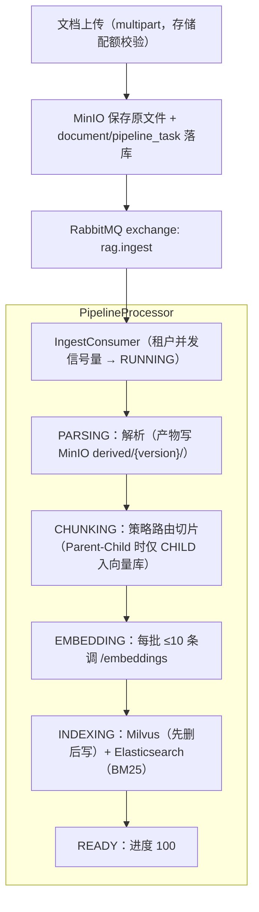
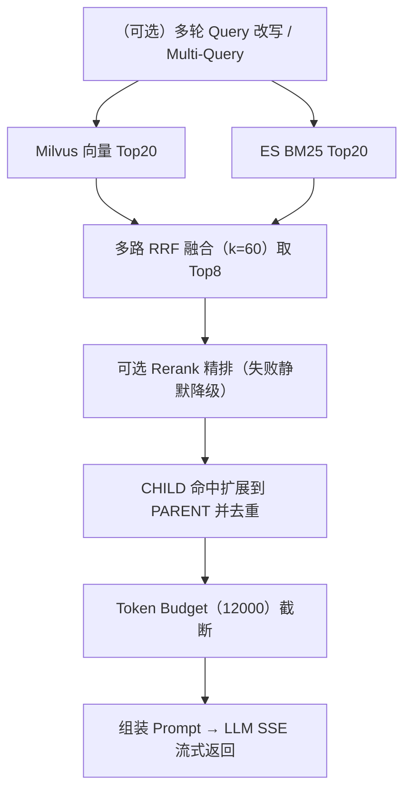
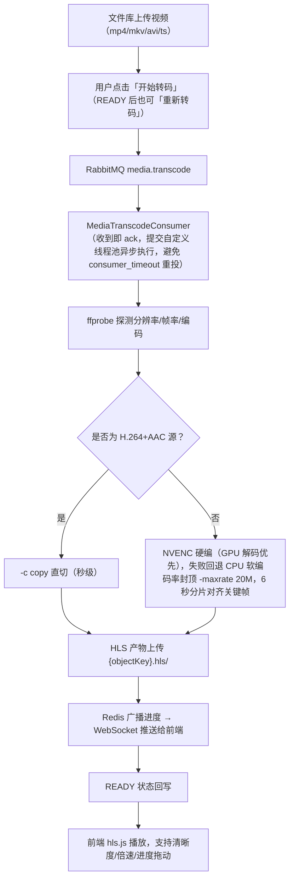

# 多租户 RAG 知识库问答平台

租户隔离的知识库管理 + 文档异步解析流水线 + 混合检索 + LLM 流式问答 + AI 文生图 + 文件库与视频转码。

## 功能特性

- **多租户隔离**：超级租户 / 租户管理员 / 普通用户三级体系，数据按 `tenant_id` 全链路隔离；菜单、工具、知识库、提示词多级授权
- **文档处理流水线**：上传 → RabbitMQ 异步消费 → 解析 → 切片 → Embedding → Elasticsearch + Milvus 双写，支持失败延迟重试与死信
- **多格式解析**：txt / md / docx / xlsx / csv / pdf（文本层 + 扫描件 Tess4J OCR）/ html / 代码文件 / 图片（Vision 多模态）
- **15 种切片策略**：固定大小、递归、段落、句子、语义、结构化、Markdown、HTML、PDF 版面、表格、QA、Parent-Child、滑动窗口、代码、AUTO
- **混合检索**：Milvus 向量召回 + ES BM25 关键词召回 → RRF 融合 → 可选 Rerank 精排 → Parent 内容扩展 → Token Budget 截断
- **流式问答**：SSE 输出（检索过程 / 引用来源 / 正文增量 / 用量统计），支持多轮会话与提示词模板；历史会话可删除（逻辑删除）
- **AI 文生图**：独立画图工作台，生成结果持久化到 MinIO，保留个人历史记录
- **文件库**：MinIO 原生分片上传（断点续传）+ 在线播放，视频自动转 HLS（H.264+AAC，NVENC 优先），音频/文本/图片即点即播；支持重新转码
- **字幕翻译**：多语言字幕导入/编辑/翻译，支持 SRT/VTT/ASS，翻译结果存档到文件库；目标语言由租户在「目标语言管理」维护；字幕条有备份表（subtitle_cue_backup），删除字幕记录后文件库归档仍可编辑
- **运维能力**：租户存储配额管理、etcd 动态配置热更、Worker 服务注册、视频转码 WebSocket 实时进度

## 技术栈

| 层 | 技术 |
|---|---|
| 后端 | Java 17、Spring Boot 3.3.5、Spring WebFlux（模型调用）、MyBatis-Plus 3.5.7 |
| 前端 | React 18、TypeScript 5、Vite 5、Ant Design 5、Zustand |
| 消息 | RabbitMQ 3.13（手动 ack、TTL + DLQ 重试、租户信号量限流） |
| 存储/检索 | MySQL 8.4、Redis 7.4、MinIO、Elasticsearch 8.14、Milvus 2.5、etcd 3.5 |
| 文档处理 | Apache PDFBox 2.x、POI、jsoup、JavaParser、Tess4J |
| 模型接入 | OpenAI 兼容 HTTP 接口（Chat / Embedding / Vision / Rerank / 文生图） |
| 视频处理 | FFmpeg 7.1（HLS、NVENC、WebSocket 实时进度推送） |

## 模块结构

三个后端模块各自独立 pom.xml（均以 `spring-boot-starter-parent` 为 parent，**模块间无父子继承**），根目录另有纯聚合 `pom.xml` 仅用于一键构建：

```
rag/
├── pom.xml             # 聚合构建（packaging=pom，仅含 modules）
├── rag-common/         # 公共 jar：25 张表实体 + Mapper + MyBatis XML + 自动填充配置
├── rag-api/            # REST API + SSE 问答 + 鉴权 + 管理后台接口（端口 8080）
├── rag-worker/         # 非 Web 进程，RabbitMQ 消费者，文档解析/切片/向量化/双写/视频转码
├── knowledge-console/  # React 管理控制台（端口 5173，/api 代理到 8080）
├── docker-compose.yml  # 本地中间件
└── rag-api/src/main/resources/db/migration/  # Flyway 迁移脚本
```

- 持久层统一在 `rag-common`（`com.rag.api.infrastructure.persistence.*`），api 与 worker 共享实体/Mapper/XML，**不存在两套实体类**
- 构建顺序：`mvn clean install`（根目录 reactor 自动先装 rag-common）；单独构建 api/worker 前需先 install rag-common
- 两个后端进程必须连接同一套中间件，并使用相同的 JWT 密钥与模型配置

## 能力实现与验收

> 状态含义：**已实现** = 代码可运行；**依赖配置** = 需在模型/系统配置页启用；**规划中** = 尚未实现，不应按现有能力宣传。

| 能力 | 状态 | 源码入口 | 验收方法 |
|---|---|---|---|
| 混合检索（向量 + BM25 + RRF） | 已实现 | `rag-api/.../RetrievalService` | 提问后查看 SSE `search_result` 的 citations 与 `degraded` 字段 |
| Rerank 二阶段精排 | 依赖配置（RERANK 模型） | `RerankClient`、`RetrievalService#rerankIfEnabled` | 启用前后对比 Top-K 顺序；`/actuator/metrics/rag.rerank.outcome`；Base URL 为 `.../v1`、裸域名或 `/compatible-mode/v1` 时自动在标准 `/rerank` 与 DashScope 原生路径间回退（仅 404/405 切换） |
| 检索通道降级 | 已实现 | `RetrievalService` 通道级 try/catch | 停用 ES 或 Embedding 后提问：仍返回引用且 `degraded=true`；双通道故障返回 UPSTREAM 错误 |
| 检索可观测性 | 已实现 | Micrometer 指标 `rag.retrieval.*` | `GET /actuator/metrics/rag.retrieval.duration`（含 P95） |
| Query 改写 / Multi-Query | 已实现（默认开启） | `QueryRewriteService`、`RetrievalService#retrieve(..., extraQueries)` | 多轮对话时 RRF 日志出现 `queries=N` 且多路结果去重；`RAG_QUERY_REWRITE_ENABLED=false` 可关闭 |
| Agentic 工具编排 | 已实现（启用外部工具时） | `ChatOrchestrator`、`LlmClient#kbSearchTool` | 天气/Tavily/`kb_search` 多轮统一编排，引用逐次累积并推送 `search_result`；真机验证工具+知识库组合、权限拒绝、工具失败/超时与无答案拒答四条路径 |
| 上传 → 解析 → 切片 → 双写 | 已实现 | `DocumentAppService`、`PipelineProcessor` | 上传后点击「开始处理」，文档状态到 READY 且进度 100 |
| 双索引一致性校验 | 已实现 | `PipelineProcessor#indexAll` | `GET /api/v1/documents/{id}/index-status` 返回 `consistent=true` |
| 任务可靠性（claim / 重试 / 僵尸恢复） | 已实现 | `IngestConsumer`、`StaleTaskRecovery` | 并发饱和不丢任务；重启后超时 PENDING/RUNNING 被重投 |
| 死信重放 | 已实现 | `PipelineOpsService` | `POST /api/v1/ops/pipeline/dlq/replay`（平台管理员） |
| 队列积压观测 | 已实现 | `PipelineOpsService#queueDepths` | `GET /api/v1/ops/pipeline/queues`（平台管理员） |
| PDF 内嵌图片理解 | 已实现（OCR 可直接用，Vision 需配置） | `pipeline/pdf/PdfLayoutExtractor`、`ParseService#parsePdf` | 图文混排 PDF 检索图片内文字；图片描述按版面位置插入对应页文本 |
| 表格结构化（Word/Excel/HTML/CSV） | 已实现 | `pipeline/table/TableModel`、`ChunkSupport#mergeContinuedTables` | 多 Sheet Excel、合并单元格、跨页续接表格可按表头+数据行检索 |
| 重建索引可用性（先写后删） | 已实现 | `PipelineProcessor#indexAll`、`EsIndexer#deleteStale`、`MilvusIndexer#deleteStale` | 新版本写入成功后才清理陈旧 chunk；重建期间旧索引保持可读，失败重试幂等收敛 |
| 索引别名级双版本切换 | 已实现 | `PipelineProcessor#rebuildKbFlow`、`EsIndexer#switchAlias`、`MilvusIndexer#switchAlias`、`KnowledgeBaseService#rebuildIndex` | `POST /api/v1/knowledge-bases/{id}/rebuild-index` 后台重建新版本物理索引，完成后原子切换 `{base}_active` 读别名，重建期间旧版本持续可读 |
| ES 中文分词与检索调优 | 已实现 | `EsSearchClient`、`EsIndexer`、`RetrievalLayeredEvalTest` | 默认 `cjk` 分词 + `content.exact` 精确字段 + 检索指标 + 五层召回与通道预算扫描评测 |
| PDF bbox 表格识别与合并单元格 | 已实现（矢量网格优先，启发式回退） | `pipeline/pdf/PdfLayoutExtractor` | 优先用 `PDFGraphicsStreamEngine` 捕获的矢量线段重建规则网格并生成 `colspan/rowspan`，无矢量线时回退行内空隙切列 + 跨行列首对齐；转 `TableModel` Markdown 嵌入页文本，误判受对齐率/单元格长度约束 |
| PDF 跨页表格续接 | 已实现 | `pipeline/pdf/PdfTableContinuation` | 列数一致且续页重复表头或紧贴页顶时合并数据行并去重表头；整页只剩接续表格与页码时并入上一页，避免表格被页边界切断 |
| PDF 版面元数据 | 已实现 | `ChunkMetadataResolver`、`chunk.bbox` / `chunk.source_id`（V10） | child 记录页面区域 `x,y,w,h` 与来源块 `p3-b2`，SSE citation 返回；非 PDF/定位失败仅保留页码 |
| PDF 结构化 Block 语义分类 | 已实现 | `pipeline/pdf/PdfLayoutExtractor`（`BlockKind`）、`ParseService#removeHeadersFooters` | 八类 `TITLE/PARAGRAPH/LIST/TABLE/IMAGE/CODE/FORMULA/HEADER_FOOTER`；标题按字号、列表按标记、代码按等宽字体/代码行、公式按符号密度分类，页眉页脚按页边距带跨页重复与页码样式剔除 |
| 块语义元数据 | 已实现 | `ChunkMetadataResolver`、`chunk.block_type`（V26）、`RetrievalService.Citation#blockType` | child 落库块类别，SSE `search_result` 的 citation 返回 `blockType` |
| RAG Evaluation 基线（召回侧） | 已实现 | `rag-api/.../eval/RetrievalMetrics`、`RetrievalBaselineTest` | `mvn -f rag-api/pom.xml test -Dtest=RetrievalBaselineTest`，报告输出 `rag-api/target/eval/retrieval-baseline.json` |
| RAG Evaluation 答案指标 | 已实现（按需在线） | `AnswerMetrics`、`OpenAiAnswerJudge`、`AnswerBaselineTest` | 离线跑引用精确率/拒答正确率；设 `RAG_EVAL_ANSWER=true` + `RAG_EVAL_BASE_URL/API_KEY/MODEL` 后用 CHAT 模型判分 Faithfulness / Answer Relevance，报告输出 `rag-api/target/eval/answer-baseline.json` |
| RAG Evaluation 分层召回（RAG-014） | 已实现（离线） | `RetrievalLayeredEvalTest` | 按中文/英文/数字/订单号/接口名五层分别统计 Recall@5 / MRR@5 / nDCG@5，并输出 vectorTopN·keywordTopN 预算敏感性；报告输出 `rag-api/target/eval/retrieval-layered.json` |
| 检索参数前后对比（RAG-009） | 已实现（离线，可选真实 Rerank） | `RetrievalTuningCompareTest`、`ChunkStrategyCompareTest` | Top-K 3/5/8/10 + Rerank 前后指标对比，报告 `rag-api/target/eval/tuning-compare.json`；七种切片策略父子数量/长度/token 对比，报告 `rag-worker/target/eval/chunk-strategy-compare.json` |
| Query 改写前后评测（RAG-013） | 已实现（离线固定集） | `QueryRewriteEvalTest` | 多轮/歧义 6 条样本输出改写前后 Recall/MRR/nDCG、引用精确率、拒答与延迟，报告 `rag-api/target/eval/rewrite-compare.json` |

### 索引与重建语义

- **删除文档**：DB 逻辑删除后删除 ES / Milvus 中该 `documentId` 的全部条目；任一路删除失败会抛错，由重试或人工补偿，避免残留孤儿索引。
- **重新解析（PARSE）**：只删除 `status=AUTO` 的旧切片，人工切片保留；新切片落库后重建双索引。
- **重建索引（REINDEX）**：保留既有切片（含人工），仅重新 Embedding 并重写双索引，切片 ID 不变。
- **写入顺序（先写后删）**：Milvus 按 `chunk_id` upsert、ES 按 `_id` 覆盖，双路新索引写成功后才删除不属于本次集合的旧 chunk；写入失败不清理旧索引，MQ 重试幂等收敛。
- **知识库级重建（别名级双版本）**：`POST /api/v1/knowledge-bases/{id}/rebuild-index`（租户管理员）投递 `REBUILD_KB` 任务，Worker 写入新版本物理索引（`{base}_v{N}`），全部文档校验通过后原子切换读别名 `{base}_active`，再更新 `index_version` 并清理旧版本。重建期间检索与上传处理读写的都是旧版本（新增/更新文档会同时写目标版本），失败保持 `BUILDING`、旧版本可读，重试耗尽后自动复位 `IDLE`。
- **历史索引兼容**：未执行过重建的知识库 `index_version=0`，读别名不存在时自动回退逻辑基名 `kb_{id}`，无需停机迁移。
- **手动编辑切片**：编辑 AUTO child 会使其脱离 parent，后续重解析不再覆盖该切片。
- **Milvus 维度变更**：仅当集合被确认（行数探测成功且为 0）为空时允许重建，且需显式开启 `rag.milvus.allow-auto-recreate=true`；drop 前输出 `[AUDIT]` 日志。
- **回滚**：代码回滚到无别名逻辑后，把 `{base}_active` 指向的物理索引改名为 `kb_{id}` 并删除别名即可（或重新上传/重建）；重建前如需完整快照仍由运维对 Milvus / ES 执行。Flyway V27 仅新增三列，旧代码不读取，可直接保留。

### ES 分词与检索调优

- **分词器**：`rag.es.analyzer` 默认 `cjk`（ES 内置中文二元分词，无需安装插件），可用 `RAG_ES_ANALYZER` 覆盖；rag-api 与 rag-worker 必须保持一致。
- **精确匹配**：`content` 增加 `content.exact`（keyword，ignore_above=256）子字段，订单号、错误码、接口名整串命中时加权 2.0，避免分词后语义漂移。
- **mapping/analyzer 迁移**：已创建的索引不会自动更新 mapping。修改 analyzer 或 mapping 后需删除该知识库索引并重新解析文档（`DELETE /api/v1/knowledge-bases/{id}` 会删除索引，或由运维手动删除后重建）；否则新老索引分词规则不一致。
- **检索参数**：`vectorTopN / keywordTopN / rrf-k / candidateTopK / topK / finalTopK / max-context-tokens` 可由 etcd `/rag/config/global/retrieval` 热更覆盖，真实数据调参前请先用固定评测集记录基线。
- **分层评测与预算敏感性**：`mvn -f rag-api/pom.xml test -Dtest=RetrievalLayeredEvalTest` 按中文/英文/数字/订单号/接口名分层输出 Recall@5、MRR@5、nDCG@5，并对 `vectorTopN`·`keywordTopN` 做 5/10/20/30 档扫描；当前默认 20 档可完整覆盖长尾相关块（10 档整体 Recall@5 掉到 0.875），报告见 `rag-api/target/eval/retrieval-layered.json`。
- **可观测指标**：`rag.retrieval.duration`（P50/P95）、`rag.retrieval.total`、`rag.retrieval.empty`、`rag.retrieval.channel_unavailable`、`rag.retrieval.channel_overlap`、`rag.rerank.outcome`，通过 `/actuator/metrics` 查询。

### Query 改写与 Multi-Query

- `rag.query-rewrite.enabled` 默认 `true`；仅多轮对话触发一次非流式模型调用（`max-queries` 默认 3、`timeout-seconds` 默认 8、输出上限 256 tokens），首轮提问、含精确标识（编号/错误码/路径/代码符号）的问题直接跳过，失败/超时一律回退原始 Query。
- 改写结果与原问题一起进入多路 RRF（每个 Query × 每个通道各算一路），去重后继续 Rerank 与 Token Budget。

## 快速开始

### 1. 环境要求

- JDK 17、Maven 3.8+、Node.js 18+、Docker / Docker Compose
- Windows 需单独配置 FFmpeg 7.1 x64 路径（`rag.media.ffmpeg-path`）

### 2. 启动中间件

```bash
docker compose up -d mysql redis minio mc-init etcd elasticsearch milvus
```

> **RabbitMQ 提示**：compose 中 `rabbitmq` 服务默认被注释，Worker 依赖它。本地运行前请取消注释后执行 `docker compose up -d rabbitmq`，或自备 RabbitMQ（5672 / 15672，guest/guest）。

所有中间件默认地址指向 `192.168.1.200`。如果中间件部署在本机，启动后端时设置环境变量 `MIDDLEWARE_HOST=127.0.0.1` 即可整体切换，也可用 `MYSQL_HOST`、`MINIO_PORT`、`ES_PORT`、`MILVUS_PORT`、`ETCD_PORT` 等单独覆盖。

### 3. 初始化数据库

使用 **Flyway** 自动管理数据库版本，rag-api 启动时会自动执行迁移脚本。

1. 在 MySQL 中创建数据库（应用默认连接库名为 `rag`）：

   ```sql
   CREATE DATABASE rag DEFAULT CHARACTER SET utf8mb4 COLLATE utf8mb4_unicode_ci;
   ```

2. 直接启动 rag-api，Flyway 会自动执行 `V1__init_schema.sql` 建表并写入种子数据。

> 已有数据库：若库中残留旧的 `flyway_schema_history` 表（项目早期遗留），需先执行 `DROP TABLE flyway_schema_history;` 再启动，否则 Flyway 校验会失败。空库无需任何手动操作。
>
> 也可以直接使用 compose 自动创建的 `rag` 库，然后以环境变量 `MYSQL_DB=rag` 启动两个后端进程。

### 4. 启动后端

```bash
# Windows PowerShell 不支持 &&，以下命令可直接分别执行
mvn -f rag-api/pom.xml spring-boot:run      # http://localhost:8080
mvn -f rag-worker/pom.xml spring-boot:run   # 无 Web 端口，纯 MQ 消费者
```

首次启动时 rag-api 的 `DataInitializer` 会创建平台管理员种子账号：

- 用户名：`admin`
- 密码：`admin123`
- 挂载在超级租户 `000000` 下

### 本地账号一览

| 系统 | 地址 | 账号 | 说明 |
|---|---|---|---|
| 管理控制台 | http://localhost:5173 | `admin / admin123` | 平台管理员种子账号（超级租户 `000000`） |
| MySQL | `127.0.0.1:3306` | `root / rag123456` | 库名 `rag`，可用 `MYSQL_USER` / `MYSQL_PASSWORD` 覆盖 |
| MinIO | API `9000` / 控制台 `9001` | `minioadmin / minioadmin123` | 桶 `rag-files`（业务）、`a-bucket`（Milvus） |
| RabbitMQ | AMQP `5672` / 控制台 `15672` | `guest / guest` | 交换机 `rag.ingest`、`media.transcode` |
| Redis | `6379` | 无密码 | 进度广播 / 缓存 |
| Elasticsearch | `9200` | 无认证 | 本地单节点，`xpack.security.enabled=false` |
| etcd | `2379` | 无认证 | 动态配置前缀 `/rag/` |

> 以上均为本地开发默认值，生产部署必须全部修改（尤其 `RAG_JWT_SECRET` 与各中间件口令）。

### 5. 启动前端

```bash
cd knowledge-console
npm install
npm run dev        # http://localhost:5173
```

### 6. 登录后配置

以 admin 登录管理控制台，至少完成：

1. **模型配置**：启用 CHAT / EMBEDDING 模型（OpenAI 兼容 Base URL + API Key），否则无法问答和向量化
2. **租户管理**：创建租户与租户管理员
3. **知识库**：新建知识库（选择切片策略），上传文档等待解析完成
4. 如需 Rerank、Vision、文生图、天气 / Tavily 工具，在对应配置页填写

## 构建与测试

```bash
mvn -f rag-api/pom.xml clean compile -DskipTests
mvn -f rag-api/pom.xml test                   # 租户隔离 + RAG 检索指标基线
mvn -f rag-worker/pom.xml clean test          # 切片 / 解析 / 表格 / 状态机测试

cd knowledge-console
npm run typecheck                             # tsc --noEmit
npm run build
```

## 核心链路

### 文档处理



问答检索：



SSE 事件：`session` / `search_start` / `search_result`（含引用）/ `message`（增量）/ `done`（用量）/ `error`。

### 视频转码



转码实时进度通过 WebSocket（`/ws/media-progress`）推送，无需轮询。Worker 的三个消费者（文档解析 / 转码 / SHA-256）统一由 `ExecutorConfig` 自定义线程池承载。

## 主要配置

后端配置命名空间为 `rag.*`，均可用环境变量覆盖，常用项：

| 环境变量 | 默认值 | 说明 |
|---|---|---|
| `MIDDLEWARE_HOST` | `192.168.1.200` | Redis/RabbitMQ/MinIO/Milvus/ES/etcd 统一主机 |
| `MYSQL_HOST` / `MYSQL_PORT` / `MYSQL_DB` / `MYSQL_USER` / `MYSQL_PASSWORD` | `192.168.1.200` / `3306` / `rag` / `root` / `rag123456` | MySQL 连接 |
| `RAG_JWT_SECRET` | 开发默认值 | JWT 签名密钥，**生产环境必须修改**，且 API / Worker 保持一致 |
| `MINIO_PORT` / `MINIO_USER` / `MINIO_PASSWORD` / `MINIO_BUCKET` | `9000` / `minioadmin` / `minioadmin123` / `rag-files` | MinIO |
| `ES_PORT` / `MILVUS_PORT` / `ETCD_PORT` | `9200` / `19530` / `2379` | 检索组件端口 |
| `RAG_OCR_TESSDATA` / `RAG_OCR_LANGS` | 空 / `chi_sim+eng` | OCR 训练数据目录与语言，留空则 OCR 静默降级 |
| `RAG_MEDIA_FFMPEG_PATH` | `D:\release\rag\tools\ffmpeg-7.1\bin\ffmpeg.exe` | FFmpeg 路径（Windows 需正确配置） |

检索参数（top-k、rrf-k、max-context-tokens 等）在 `application.yml` 中有兜底值，并可通过 etcd 路径 `/rag/config/global/retrieval` 热更覆盖。

## Linux 服务器部署注意事项

### 容器开机自启

`docker-compose.yml` 中 6 个常驻服务（mysql、redis、minio、etcd、elasticsearch、milvus）均已配置 `restart: unless-stopped`：Linux 重启后 Docker 守护进程会自动拉起容器；手动 `docker compose stop/down` 过的容器不会自动启动。

- `mc-init` 是一次性建桶任务（跑完即退出），未配置重启策略，避免反复执行
- 修改过 restart 策略后需重建容器才能生效：`docker compose up -d`

### 重启后端口映射正常但 telnet 不通

**现象**：服务器重启后 `docker ps` 端口映射显示正常，但 `telnet <ip> <端口>` 不通，再次重启服务器才恢复。

**根因**：firewalld/iptables 与 Docker 的启动顺序冲突——Docker 启动时向 iptables 写入 `DOCKER` 链做 DNAT（端口映射真正生效靠它），若 firewalld 在 Docker 之后启动或 reload，会重建/清空 iptables 规则并抹掉 `DOCKER` 链，导致容器在跑、映射在显示，但 DNAT 规则丢失。

**验证**（故障复现时在服务器上执行）：

```bash
iptables -S DOCKER | head    # 输出为空或报错 → 规则被清了
systemctl show docker firewalld -p ActiveEnterTimestamp    # 对比两者启动时间
```

**修复**：让 Docker 在网络和防火墙就绪之后再启动（一次性配置）：

```bash
mkdir -p /etc/systemd/system/docker.service.d
cat > /etc/systemd/system/docker.service.d/override.conf <<'EOF'
[Unit]
After=network-online.target firewalld.service nftables.service
Wants=network-online.target
EOF
systemctl daemon-reload
```

服务器未启用 firewalld 时此配置同样无害（`After` 只是顺序声明）。配置后重启验证：开机后直接 `telnet <ip> <端口>` 应立即通。

**兜底方案**：个别发行版 firewalld 异步 reload 仍可能复现，可在服务器加开机任务延迟重启 Docker：

```bash
(crontab -l; echo "@reboot sleep 30 && systemctl restart docker") | crontab -
```

## 进一步阅读

- [AGENTS.md](AGENTS.md) — 项目全貌、架构地图、编码约定与常见坑位
- [CODE_INTRO.md](CODE_INTRO.md) — 代码逐包导读与关键流程详解
- [RAG_DOCUMENT_PROCESSING_PIPELINE.md](RAG_DOCUMENT_PROCESSING_PIPELINE.md) — 文档解析 / 切片 / 多模态 / 检索完整规格（§1–§32）
