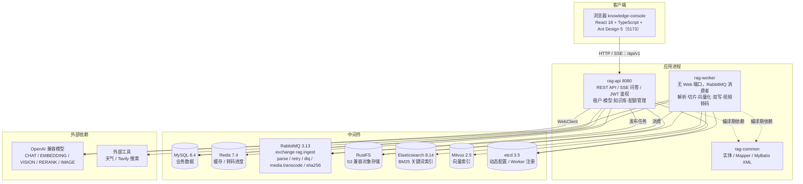
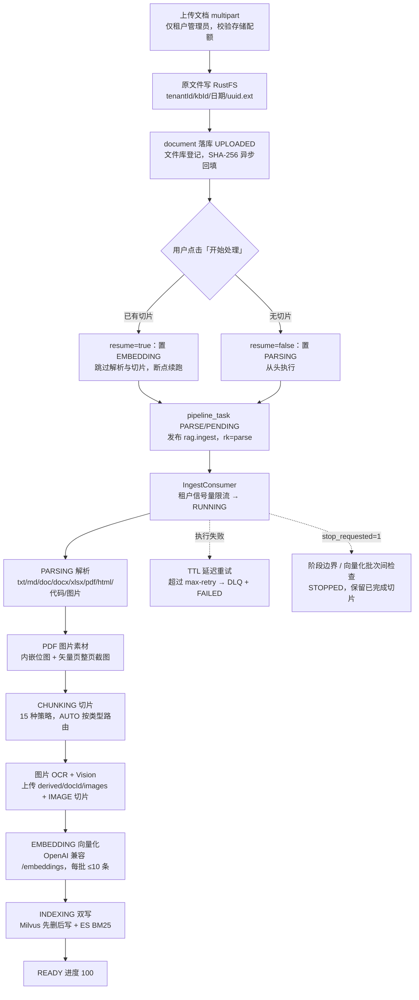
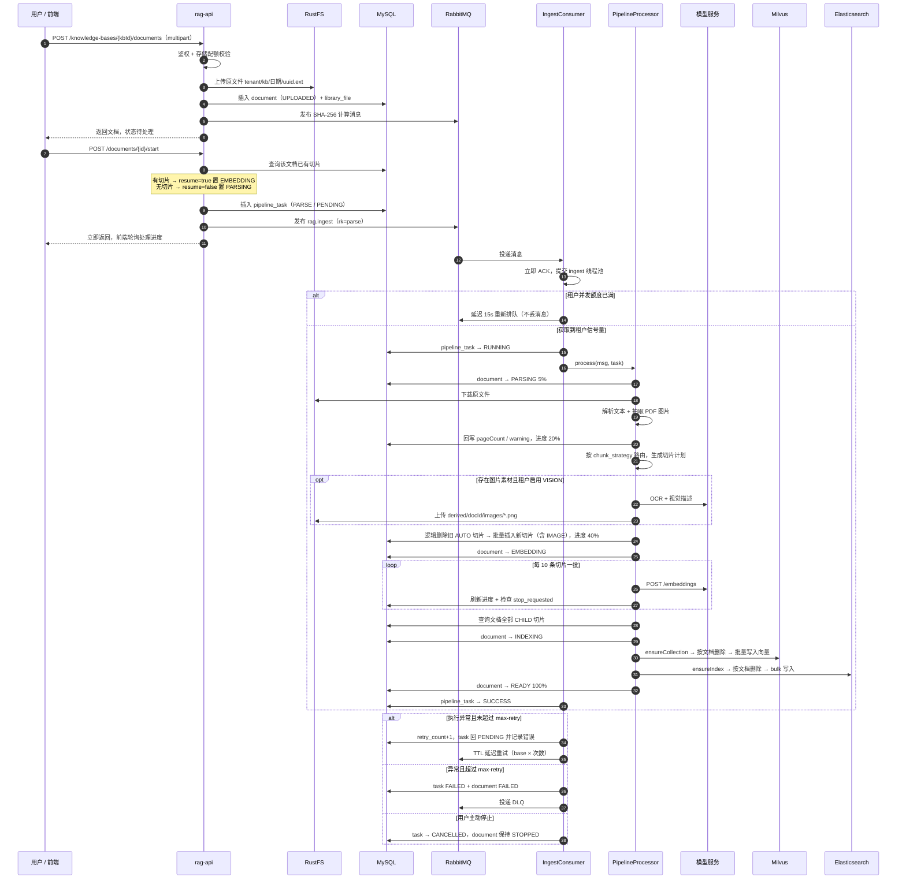
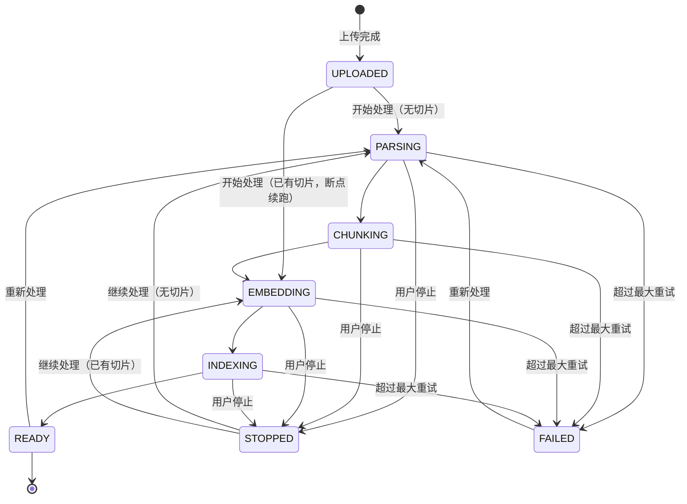
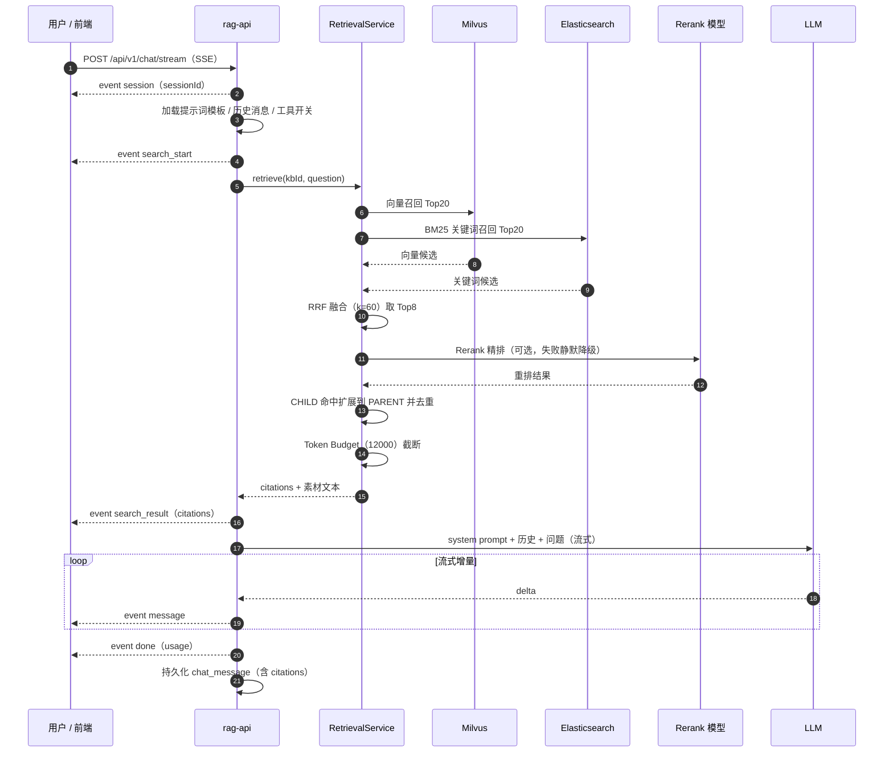
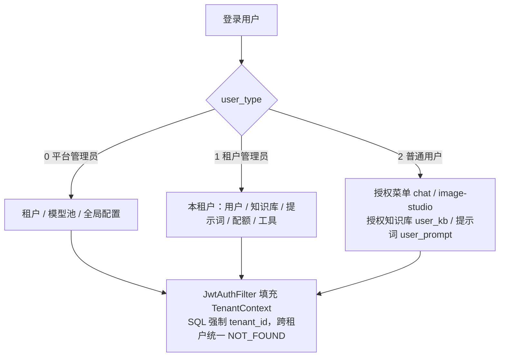
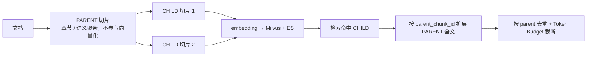
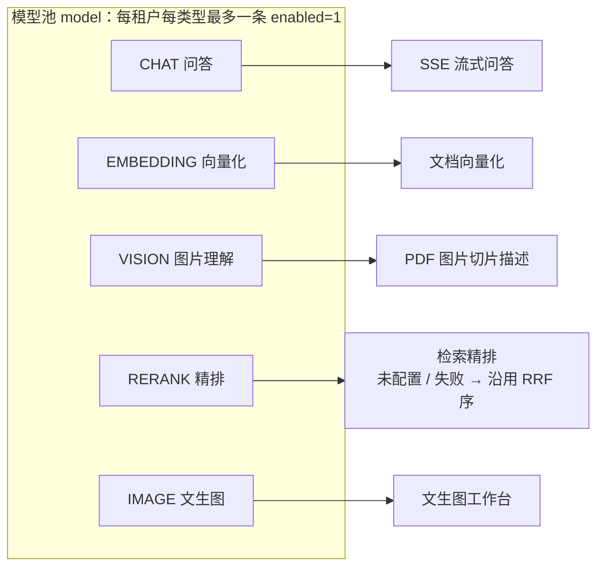

# 多租户 RAG 知识库问答平台

租户隔离的知识库管理 + 文档异步解析流水线 + 混合检索 + LLM 流式问答 + AI 文生图 + 文件库与视频转码。

## 功能特性

- **多租户隔离**：超级租户 / 租户管理员 / 普通用户三级体系，数据按 `tenant_id` 全链路隔离；菜单、工具、知识库、提示词多级授权
- **文档处理流水线**：上传 → RabbitMQ 异步消费 → 解析 → 切片 → Embedding → Elasticsearch + Milvus 双写，支持失败延迟重试与死信
- **多格式解析**：txt / md / docx / xlsx / csv / pdf（文本层 + 扫描件 Tess4J OCR）/ html / 代码文件 / 图片（Vision 多模态）
- **15 种切片策略**：固定大小、递归、段落、句子、语义、结构化、Markdown、HTML、PDF 版面、表格、QA、Parent-Child、滑动窗口、代码、AUTO
- **混合检索**：Milvus 向量召回 + ES BM25 关键词召回 → RRF 融合 → 可选 Rerank 精排 → Parent 内容扩展 → Token Budget 截断
- **流式问答**：SSE 输出（检索过程 / 引用来源 / 正文增量 / 用量统计），支持多轮会话与提示词模板；历史会话可删除（逻辑删除）
- **AI 文生图**：独立画图工作台，生成结果持久化到对象存储（RustFS），保留个人历史记录
- **文件库**：S3 原生分片上传（断点续传）+ 在线播放，视频自动转 HLS（H.264+AAC，NVENC 优先），音频/文本/图片即点即播；支持重新转码
- **字幕翻译**：多语言字幕导入/编辑/翻译，支持 SRT/VTT/ASS，翻译结果存档到文件库；目标语言由租户在「目标语言管理」维护；字幕条有备份表（subtitle_cue_backup），删除字幕记录后文件库归档仍可编辑
- **运维能力**：租户存储配额管理、etcd 动态配置热更、Worker 服务注册、视频转码 WebSocket 实时进度

## 技术栈

| 层 | 技术 |
|---|---|
| 后端 | Java 17、Spring Boot 3.3.5、Spring WebFlux（模型调用）、MyBatis-Plus 3.5.7 |
| 前端 | React 18、TypeScript 5、Vite 5、Ant Design 5、Zustand |
| 消息 | RabbitMQ 3.13（手动 ack、TTL + DLQ 重试、租户信号量限流） |
| 存储/检索 | MySQL 8.4、Redis 7.4、RustFS（S3 兼容）、Elasticsearch 8.14、Milvus 2.5、etcd 3.5 |
| 文档处理 | Apache PDFBox 2.x、POI、jsoup、JavaParser、Tess4J |
| 模型接入 | OpenAI 兼容 HTTP 接口（Chat / Embedding / Vision / Rerank / 文生图） |
| 视频处理 | FFmpeg 7.1（HLS、NVENC、WebSocket 实时进度推送） |

## 模块结构

四个模块各自独立 pom.xml，**无 Maven 父子聚合**（根目录 `pom.xml` 仅用于聚合构建）：

```
rag/
├── rag-common/         # 公共持久层：实体 + Mapper 接口 + MyBatis XML（api / worker 共享）
├── rag-api/            # REST API + SSE 问答 + 鉴权 + 管理后台接口（端口 8080）
├── rag-worker/         # 非 Web 进程，RabbitMQ 消费者，文档解析/切片/向量化/双写/视频转码
├── knowledge-console/  # React 管理控制台（端口 5173，/api 代理到 8080）
├── docker-compose.yml  # 本地中间件
└── rag-api/src/main/resources/db/migration/  # Flyway 迁移脚本
```

- 实体 / Mapper / MyBatis XML 统一在 `rag-common`（`com.rag.api.infrastructure.persistence.*`），api 与 worker 共享，不再各自维护持久层
- 两个后端进程必须连接同一套中间件，并使用相同的 JWT 密钥与模型配置

## 系统架构



- **rag-api** 负责同步交互：鉴权、管理接口、检索编排与 SSE 流式问答，不执行重任务
- **rag-worker** 负责异步重任务：文档解析/切片/向量化/双写、视频转码、SHA-256 计算，按租户信号量限流
- **etcd** 同时承担 Milvus 元数据后端与业务动态配置（`/rag/config/global/retrieval` 可热更检索参数），Worker 启动时注册自身

## 快速开始

### 1. 环境要求

- JDK 17、Maven 3.8+、Node.js 18+、Docker / Docker Compose
- Windows 需单独配置 FFmpeg 7.1 x64 路径（`rag.media.ffmpeg-path`）

### 2. 启动中间件

```bash
docker compose up -d mysql redis rustfs rustfs-init etcd elasticsearch milvus
```

> **RabbitMQ 提示**：compose 中 `rabbitmq` 服务默认被注释，Worker 依赖它。本地运行前请取消注释后执行 `docker compose up -d rabbitmq`，或自备 RabbitMQ（5672 / 15672，guest/guest）。

所有中间件默认地址为 `127.0.0.1`（本机）。如果中间件部署在其他机器，启动后端时设置环境变量 `MIDDLEWARE_HOST=<中间件主机IP>` 即可整体切换，也可用 `MYSQL_HOST`、`RUSTFS_PORT`、`ES_PORT`、`MILVUS_PORT`、`ETCD_PORT` 等单独覆盖。

### 3. 初始化数据库

使用 **Flyway** 自动管理数据库版本，rag-api 启动时会自动执行迁移脚本。

1. 在 MySQL 中创建数据库（应用默认连接库名为 `rag`）：

   ```sql
   CREATE DATABASE rag DEFAULT CHARACTER SET utf8mb4 COLLATE utf8mb4_unicode_ci;
   ```

2. 直接启动 rag-api，Flyway 会自动执行 `V1__init_schema.sql` 建表并写入种子数据。

> 已有数据库：若库中残留旧的 `flyway_schema_history` 表（项目早期遗留），需先执行 `DROP TABLE flyway_schema_history;` 再启动，否则 Flyway 校验会失败。空库无需任何手动操作。
>
> 也可以直接使用 compose 自动创建的 `rag` 库，然后以环境变量 `MYSQL_DB=rag` 启动两个后端进程。

### 4. 启动后端

```bash
# Windows PowerShell 不支持 &&，以下命令可直接分别执行
mvn -f rag-api/pom.xml spring-boot:run      # http://localhost:8080
mvn -f rag-worker/pom.xml spring-boot:run   # 无 Web 端口，纯 MQ 消费者
```

首次启动时 rag-api 的 `DataInitializer` 会创建平台管理员种子账号：

- 用户名：`admin`
- 密码：`admin123`
- 挂载在超级租户 `000000` 下

### 5. 启动前端

```bash
cd knowledge-console
npm install
npm run dev        # http://localhost:5173
```

### 6. 登录后配置

以 admin 登录管理控制台，至少完成：

1. **模型配置**：启用 CHAT / EMBEDDING 模型（OpenAI 兼容 Base URL + API Key），否则无法问答和向量化
2. **租户管理**：创建租户与租户管理员
3. **知识库**：新建知识库（选择切片策略），上传文档等待解析完成
4. 如需 Rerank、Vision、文生图、天气 / Tavily 工具，在对应配置页填写

## 构建与测试

```bash
mvn -f rag-api/pom.xml clean compile -DskipTests
mvn -f rag-worker/pom.xml clean test          # 唯一测试：ChunkPipelineTest

cd knowledge-console
npm run typecheck                             # tsc --noEmit
npm run build
```

## 核心链路

### 文档处理



### 文档处理时序



消费者收到消息后立即 ACK，避免分钟级处理触发 RabbitMQ `consumer_timeout`；幂等由 `pipeline_task` 的 PENDING 状态约束。停止请求只在阶段边界与向量化批次间生效。

### 文档状态机



### 问答检索



SSE 事件：`session` / `search_start` / `search_result`（含引用）/ `message`（增量）/ `done`（用量）/ `error`。天气 / Tavily 工具调用复用 `search_start` 事件并携带 `stage=tool`。

### 视频转码

```
文件库上传视频（mp4/mkv/avi/ts）
  → 用户点击「开始转码」（READY 后也可「重新转码」）
  → RabbitMQ media.transcode
      → MediaTranscodeConsumer（收到即 ack，提交自定义线程池异步执行，避免 consumer_timeout 重投）
          ffprobe 探测分辨率/帧率/编码
          H.264+AAC 源 → -c copy 直切（秒级）
          其他 → NVENC 硬编（GPU 解码优先），失败回退 CPU 软编
                 码率封顶 -maxrate 20M，6 秒分片对齐关键帧
          HLS 产物上传 {objectKey}.hls/
          Redis 广播进度 → WebSocket 推送给前端
          READY 状态回写
  → 前端 hls.js 播放，支持清晰度/倍速/进度拖动
```

转码实时进度通过 WebSocket（`/ws/media-progress`）推送，无需轮询。Worker 的三个消费者（文档解析 / 转码 / SHA-256）统一由 `ExecutorConfig` 自定义线程池承载。

## 核心设计

### 多租户与权限模型



权限分两层：菜单权限（`user_feature` 的 MENU 类型 + `tenant_menu`）与工具权限（TOOL 类型）；知识库、提示词另有 `user_kb` / `user_prompt` 数据授权。

### Parent-Child 切片模型



只有 CHILD 参与 embedding 与索引；命中后回表扩展 PARENT 上下文。人工新增/编辑的切片 `status=MANUAL`，重新解析只清理 `AUTO` 切片。

### 模型池与降级策略



可选能力统一静默降级：Rerank、OCR、Vision 调用失败只打 warn 日志，不阻断主流程；未配置对应模型时功能侧自动跳过。

## 主要配置

后端配置命名空间为 `rag.*`，均可用环境变量覆盖，常用项：

| 环境变量 | 默认值 | 说明 |
|---|---|---|
| `MIDDLEWARE_HOST` | `127.0.0.1` | Redis/RabbitMQ/RustFS/Milvus/ES/etcd 统一主机 |
| `MYSQL_HOST` / `MYSQL_PORT` / `MYSQL_DB` / `MYSQL_USER` / `MYSQL_PASSWORD` | `127.0.0.1` / `3306` / `rag` / `root` / `rag123456` | MySQL 连接 |
| `RAG_JWT_SECRET` | 开发默认值 | JWT 签名密钥，**生产环境必须修改**，且 API / Worker 保持一致 |
| `RUSTFS_PORT` / `RUSTFS_USER` / `RUSTFS_PASSWORD` / `RUSTFS_BUCKET` | `9000` / `rustfsadmin` / `rustfsadmin123` / `rag-files` | RustFS 对象存储 |
| `ES_PORT` / `MILVUS_PORT` / `ETCD_PORT` | `9200` / `19530` / `2379` | 检索组件端口 |
| `RAG_OCR_TESSDATA` / `RAG_OCR_LANGS` | 空 / `chi_sim+eng` | OCR 训练数据目录与语言，留空则 OCR 静默降级 |
| `RAG_MEDIA_FFMPEG_PATH` | `D:\release\rag\tools\ffmpeg-7.1\bin\ffmpeg.exe` | FFmpeg 路径（Windows 需正确配置） |

检索参数（top-k、rrf-k、max-context-tokens 等）在 `application.yml` 中有兜底值，并可通过 etcd 路径 `/rag/config/global/retrieval` 热更覆盖。

## Linux 服务器部署注意事项

### 容器开机自启

`docker-compose.yml` 中 6 个常驻服务（mysql、redis、rustfs、etcd、elasticsearch、milvus）均已配置 `restart: unless-stopped`：Linux 重启后 Docker 守护进程会自动拉起容器；手动 `docker compose stop/down` 过的容器不会自动启动。

- `rustfs-init` 是一次性建桶任务（跑完即退出），未配置重启策略，避免反复执行
- 修改过 restart 策略后需重建容器才能生效：`docker compose up -d`

### 重启后端口映射正常但 telnet 不通

**现象**：服务器重启后 `docker ps` 端口映射显示正常，但 `telnet <ip> <端口>` 不通，再次重启服务器才恢复。

**根因**：firewalld/iptables 与 Docker 的启动顺序冲突——Docker 启动时向 iptables 写入 `DOCKER` 链做 DNAT（端口映射真正生效靠它），若 firewalld 在 Docker 之后启动或 reload，会重建/清空 iptables 规则并抹掉 `DOCKER` 链，导致容器在跑、映射在显示，但 DNAT 规则丢失。

**验证**（故障复现时在服务器上执行）：

```bash
iptables -S DOCKER | head    # 输出为空或报错 → 规则被清了
systemctl show docker firewalld -p ActiveEnterTimestamp    # 对比两者启动时间
```

**修复**：让 Docker 在网络和防火墙就绪之后再启动（一次性配置）：

```bash
mkdir -p /etc/systemd/system/docker.service.d
cat > /etc/systemd/system/docker.service.d/override.conf <<'EOF'
[Unit]
After=network-online.target firewalld.service nftables.service
Wants=network-online.target
EOF
systemctl daemon-reload
```

服务器未启用 firewalld 时此配置同样无害（`After` 只是顺序声明）。配置后重启验证：开机后直接 `telnet <ip> <端口>` 应立即通。

**兜底方案**：个别发行版 firewalld 异步 reload 仍可能复现，可在服务器加开机任务延迟重启 Docker：

```bash
(crontab -l; echo "@reboot sleep 30 && systemctl restart docker") | crontab -
```

## 进一步阅读

- [AGENTS.md](AGENTS.md) — 项目全貌、架构地图、编码约定与常见坑位
- [CODE_INTRO.md](CODE_INTRO.md) — 代码逐包导读与关键流程详解
- [RAG_DOCUMENT_PROCESSING_PIPELINE.md](RAG_DOCUMENT_PROCESSING_PIPELINE.md) — 文档解析 / 切片 / 多模态 / 检索完整规格（§1–§32）
